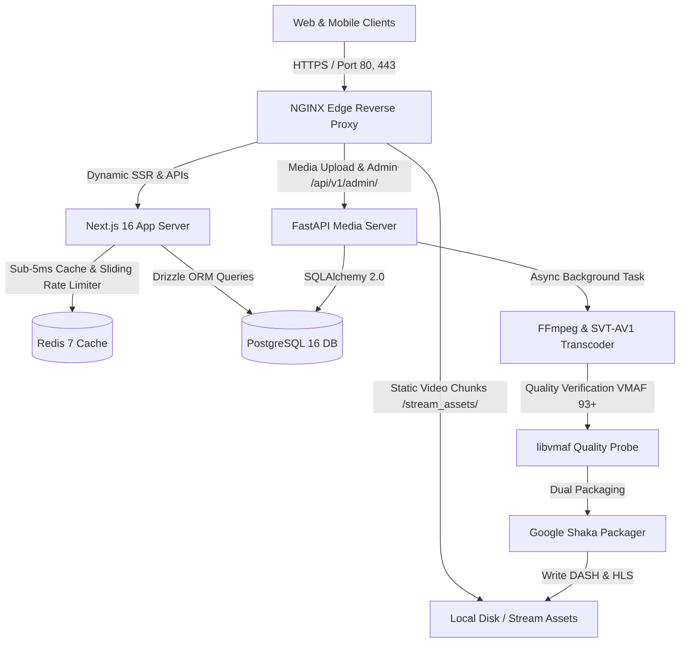
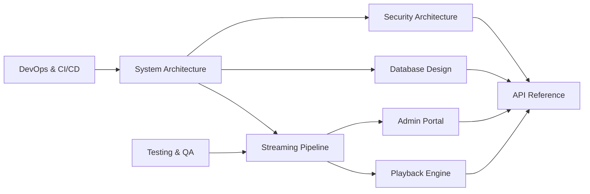

# 📖 StreamVault Enterprise Documentation Hub

| Metadata | Details |
| :--- | :--- |
| **Title** | StreamVault Master Documentation Index & Portal |
| **Version** | 2.0.0 (Production Multi-Codec Enterprise Edition) |
| **Author** | Principal Software Architect & Principal Engineering Lead |
| **Date** | 2026-09-29 |
| **Purpose** | Central entry point and navigable index for all architectural, operational, security, and developer specifications. |
| **Scope** | Complete StreamVault video streaming platform, including Next.js web application, FastAPI media server, NGINX reverse proxy, PostgreSQL database, Redis caching layer, and Kubernetes deployment. |

---

## 📑 Table of Contents

- [1. Executive Summary](#1-executive-summary)
- [2. System Architecture Blueprint](#2-system-architecture-blueprint)
- [3. Complete Documentation Suite Sitemap](#3-complete-documentation-suite-sitemap)
  - [3.1 Architecture & Engineering](#31-architecture--engineering)
  - [3.2 Streaming & Playback Engine](#32-streaming--playback-engine)
  - [3.3 Backend & APIs](#33-backend--apis)
  - [3.4 Database & Data Models](#34-database--data-models)
  - [3.5 Security & Compliance](#35-security--compliance)
  - [3.6 DevOps, Operations & Cloud](#36-devops-operations--cloud)
  - [3.7 Client & Admin Portals](#37-client--admin-portals)
  - [3.8 AI & Search Discovery](#38-ai--search-discovery)
  - [3.9 Quality Assurance & Testing](#39-quality-assurance--testing)
  - [3.10 Audits & Executive Reports](#310-audits--executive-reports)
- [4. Implementation Reality vs Recommendations](#4-implementation-reality-vs-recommendations)
- [5. Cross-Reference Matrix](#5-cross-reference-matrix)
- [6. Maintenance and Contribution Guidelines](#6-maintenance-and-contribution-guidelines)

---

## 1. Executive Summary

**StreamVault** is an enterprise-grade, high-concurrency Over-The-Top (OTT) video streaming platform designed to mirror modern tier-1 streaming systems (e.g., Netflix, Disney+). The platform integrates a modern web front-end built on **Next.js 16 (App Router)** and **React 19**, an asynchronous media processing engine powered by **FastAPI** and **FFmpeg/SVT-AV1**, a dual-engine database architecture utilizing **PostgreSQL 16** with **Drizzle ORM** and **SQLAlchemy 2.0**, and an edge caching layer backed by **Redis 7** and **NGINX**.

Adaptive streaming is delivered through **Google Shaka Player** with automated fallback to **Hls.js**, rendering dual **MPEG-DASH (`.mpd`)** and **HLS (`.m3u8`)** manifests generated via **Google Shaka Packager**. Real-time Quality of Experience (QoE) telemetry is ingested from client players to monitor startup latency, rebuffering stalls, dropped frames, and rendition switches.

---

## 2. System Architecture Blueprint

StreamVault is architected around the following five primary operational domains:

1. **Edge Delivery & Proxy Tier**: NGINX edge reverse proxy routing client requests, handling CORS, terminating SSL, and caching static video segments (`.m4s`, `.mp4`, `.m3u8`, `.mpd`) with HTTP byte-range support.
2. **Application & Experience Tier**: Next.js 16 running on Node.js 22, managing Server-Side Rendering (SSR), authentication state, catalog browsing, recommendations, search ranking, and QoE telemetry collection.
3. **Intelligence & Telemetry Tier**: Hybrid recommendation engine computing collaborative filtering and content genre affinity vectors, paired with a Levenshtein fuzzy search indexer and Prometheus metrics exporter (`/api/metrics`).
4. **Media Transcoding & Packaging Tier**: Python 3.11/FastAPI media server accepting 10 source containers, running SHA-256 integrity verification, FFmpeg scene-cut detection, dual-codec encoding (SVT-AV1 primary + libx264 universal fallback), libvmaf perceptual scoring, and Shaka packaging.
5. **Persistence & Caching Tier**: PostgreSQL 16 relational database maintaining users, profiles, content metadata, encoding jobs, and audit logs, combined with a Redis 7 cache-aside and distributed rate limiting cluster.

---

## 3. Complete Documentation Suite Sitemap

### 3.1 Architecture & Engineering
- [System Architecture](file:///d:/clg/Projects/Netflix/docs/system_architecture.md): Microservice topology, component breakdowns, edge proxying, cloud scaling, and high-availability design.
- [Data Flows & Sequence Diagrams](file:///d:/clg/Projects/Netflix/docs/data_flows_and_sequences.md): End-to-end data lifecycle, control flows, UML sequence diagrams, and lifecycle state machines.

### 3.2 Streaming & Playback Engine
- [Video Transcoding Pipeline](file:///d:/clg/Projects/Netflix/docs/video_streaming_pipeline.md): FFmpeg dual-codec ladder (SVT-AV1 + libx264), scene detection, VMAF 93+ analysis, Shaka packaging, and thumbnail generation.
- [Playback & Player Engine](file:///d:/clg/Projects/Netflix/docs/playback_engine.md): Google Shaka Player implementation, ABR bitrate adaptation, smart buffering (20s–60s), dynamic intro/credits skip, and QoE telemetry.

### 3.3 Backend & APIs
- [Backend Architecture](file:///d:/clg/Projects/Netflix/docs/backend_architecture.md): Next.js App Router API design, FastAPI worker service, Redis cache-aside engine, and sliding-window rate limiting.
- [REST API Reference](file:///d:/clg/Projects/Netflix/docs/api_reference.md): Detailed parameter and response specifications for all 17 API domains, including OpenAPI 3.0 definitions.

### 3.4 Database & Data Models
- [Database Design & Schema](file:///d:/clg/Projects/Netflix/docs/database_design_and_schema.md): Complete ER diagram, Drizzle ORM schema, SQLAlchemy models, indexing strategies, normalization rules, and migrations.

### 3.5 Security & Compliance
- [Security Architecture & Audit](file:///d:/clg/Projects/Netflix/docs/security_architecture_and_audit.md): Threat modeling, JWT rotation, HMAC SHA-256 signed URLs, bcrypt password hashing, OWASP Top 10 mitigation, and audit logging.
- [Compliance & Legal Standards](file:///d:/clg/Projects/Netflix/docs/compliance_and_legal.md): GDPR, CCPA, DMCA takedown policies, terms of service, privacy guidelines, and content moderation rules.

### 3.6 DevOps, Operations & Cloud
- [DevOps & CI/CD Guide](file:///d:/clg/Projects/Netflix/docs/devops_and_ci_cd.md): Docker Compose multi-container orchestration, Kubernetes manifests with HPA, GitHub Actions automation, Prometheus metrics, and disaster recovery runbooks.

### 3.7 Client & Admin Portals
- [Client Features & Specifications](file:///d:/clg/Projects/Netflix/docs/client_features_and_specifications.md): Netflix dark mode interface, multi-profile switching, kids content filtering, watch history, watchlist, star ratings, and discussion comments.
- [Admin Operations Guide](file:///d:/clg/Projects/Netflix/docs/admin_operations_guide.md): Content ingestion, live transcoding queue management, job retries, system statistics, and security audit log inspection.

### 3.8 AI & Search Discovery
- [AI Features & Search Discovery](file:///d:/clg/Projects/Netflix/docs/ai_features_and_recommendations.md): Collaborative filtering affinity vectors, cold-start algorithms, Levenshtein fuzzy distance matching, and AI expansion roadmap.

### 3.9 Quality Assurance & Testing
- [Testing Strategy & QA](file:///d:/clg/Projects/Netflix/docs/testing_strategy_and_qa.md): Automated Python pipeline unit testing, TypeScript compilation verification, E2E validation, and load testing standards.

### 3.10 Audits & Executive Reports
- [Architecture Review](file:///d:/clg/Projects/Netflix/docs/ARCHITECTURE_REVIEW.md): Deep-dive structural review of the production codebase.
- [Implementation Gap Analysis](file:///d:/clg/Projects/Netflix/docs/IMPLEMENTATION_GAP_ANALYSIS.md): Comprehensive inventory of implemented features vs recommendations.
- [Production Readiness Report](file:///d:/clg/Projects/Netflix/docs/PRODUCTION_READINESS_REPORT.md): Operational risk assessment and deployment certification.
- [Security Audit Report](file:///d:/clg/Projects/Netflix/docs/SECURITY_AUDIT_REPORT.md): Enterprise vulnerability assessment and mitigation matrix.
- [Technical Audit Report](file:///d:/clg/Projects/Netflix/docs/TECHNICAL_AUDIT_REPORT.md): Engineering benchmark evaluating code quality, database design, and streaming performance.
- [Optimization Report](file:///d:/clg/Projects/Netflix/docs/OPTIMIZATION_REPORT.md): Performance tuning guidelines for caching, database querying, and video delivery.

---

## 4. Implementation Reality vs Recommendations

To maintain strict architectural honesty, all documents distinguish between **Implemented Capabilities** and **Architectural Recommendations**:

| Domain | Implemented in Codebase | Recommended for Enterprise Scale |
| :--- | :--- | :--- |
| **Video Codecs** | SVT-AV1 (`libsvtav1`), libx264 High Profile | VP9, H.265 offline packaging, AV1 4K rendition |
| **Packaging** | Shaka Packager dual MPEG-DASH & HLS, 4s segments | Low-Latency HLS (LL-HLS), Chunked CMAF |
| **Transcoding** | FFmpeg scene score cut detection, VMAF 93+ scoring | Per-Title convex-hull bitrate optimization |
| **Player** | Shaka Player v5.2, ABR, Smart Buffer, Skip Intro/Credits | Multi-CDN latency switching, Offline encrypted storage |
| **Search & AI** | Levenshtein fuzzy distance (d≤2), Collaborative vectors | Vector embeddings (Pinecone/Milvus), Whisper speech-to-text |
| **Database** | PostgreSQL 16 (Drizzle + SQLAlchemy), composite indexes | Declarative partition tables for telemetry, read replicas |
| **Caching** | Redis cache-aside (TTL 120s–300s), sliding rate limit | Redis Sentinel / Cluster multi-region replication |
| **Observability** | `/api/metrics` Prometheus exposition, DB pool telemetry | Grafana pre-built dashboards, OpenTelemetry distributed tracing |

---

## 5. Cross-Reference Matrix

---

## 6. Maintenance and Contribution Guidelines

1. **Preserve Architectural Honesty**: When documenting features, inspect the source code (`src/` and `media_server/`) before authoring. Do not mark speculative features as implemented.
2. **Maintain Metric Consistency**: All bitrates, buffer seconds (20s–60s), cache TTLs (120s–300s), and token expiry durations (15m access / 30d refresh) must match implementation code constants.
3. **Synchronize Schema Changes**: Any modifications to `src/db/schema.ts` must be mirrored in `media_server/app/models.py` and reflected in the [Database Reference](file:///d:/clg/Projects/Netflix/docs/database_design_and_schema.md).
