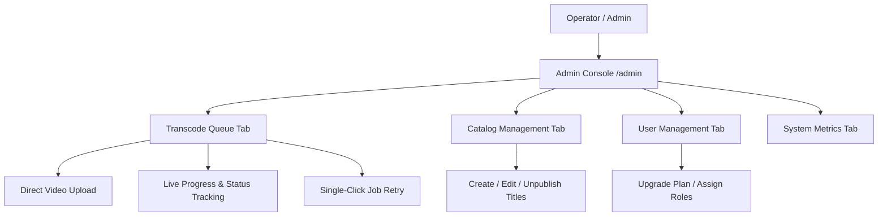

# 👑 StreamVault Admin Operations & Media Management Guide

| Metadata | Details |
| :--- | :--- |
| **Title** | Admin Operations, Live Transcode Queue Management & Content Moderation Manual |
| **Document ID** | ADM-001 |
| **Version** | 2.0.0 (Production Multi-Codec Enterprise Edition) |
| **Author** | Principal Product Manager & Operational Systems Lead |
| **Date** | 2026-09-29 |
| **Purpose** | Comprehensive operator manual covering video ingestion, real-time transcoding job monitoring, failed job recovery, catalog curation, user administration, and audit inspection. |
| **Scope** | Admin dashboard (`src/app/admin/page.tsx`), admin API routes (`src/app/api/admin/`), and media server admin routes (`media_server/app/main.py`). |

---

## 📑 Table of Contents

- [1. Operational Overview & Admin Dashboard](#1-operational-overview--admin-dashboard)
- [2. Role-Based Access Control & Permissions](#2-role-based-access-control--permissions)
- [3. Media Ingestion & Video Upload Workflow](#3-media-ingestion--video-upload-workflow)
- [4. Live Transcoding Queue Management](#4-live-transcoding-queue-management)
  - [4.1 Status Indicators & Progress Tracking](#41-status-indicators--progress-tracking)
  - [4.2 VMAF Quality Score Inspection](#42-vmaf-quality-score-inspection)
  - [4.3 Job Retry & Error Recovery Workflow](#43-job-retry--error-recovery-workflow)
- [5. Content Catalog Management (Movies & Series)](#5-content-catalog-management-movies--series)
- [6. User Administration & Subscription Management](#6-user-administration--subscription-management)
- [7. Operational Analytics & Queue Statistics](#7-operational-analytics--queue-statistics)
- [8. Security Audit Log Inspection](#8-security-audit-log-inspection)
- [9. Admin Gap Analysis & Recommendations](#9-admin-gap-analysis--recommendations)
- [10. Cross References](#10-cross-references)

---

## 1. Operational Overview & Admin Dashboard

The StreamVault Admin Console (`src/app/admin/page.tsx`) provides operations teams with complete visibility into catalog assets, user accounts, and media processing pipelines. Operators can track long-running transcode jobs in real-time, view perceptual VMAF scores, and manage published content.

---

## 2. Role-Based Access Control & Permissions

- **Enforcement**: Admin routes verify that `user.role === 'admin'`. Unauthorized requests receive `403 Forbidden`.
- **Administrative Privileges**:
  - Upload raw master video files (up to 10GB).
  - Force retry of failed transcoding tasks.
  - Delete or unpublish catalog titles.
  - Inspect immutable security audit logs.
  - Adjust user subscription tiers (`basic`, `standard`, `premium`).

---

## 3. Media Ingestion & Video Upload Workflow

Operators can ingest video directly from the dashboard:
1. Select source video file (`.mp4`, `.mkv`, `.mov`, `.avi`, `.webm`, `.m4v`, `.flv`, `.ts`, `.mpeg`, `.wmv`).
2. Optionally link the upload to an existing catalog `content_id`.
3. Submit the form; the file streams to `POST /api/v1/admin/upload`.
4. The media server computes the file hash, stores the raw asset in `uploads/sources/`, inserts a row into `encoding_jobs`, and kicks off background processing.

---

## 4. Live Transcoding Queue Management

### 4.1 Status Indicators & Progress Tracking
The live queue displays all active and historical encoding tasks:
- **`pending` (Yellow)**: Enqueued in database, awaiting worker pickup.
- **`processing` (Blue with Animated Bar)**: Active FFmpeg encoding with real-time percentage indicators ($0\% \rightarrow 100\%$).
- **`completed` (Green Check)**: DASH and HLS manifests generated and linked to catalog.
- **`failed` (Red Warning)**: Pipeline encountered corrupted frame or process error; detailed stacktrace visible in error modal.

### 4.2 VMAF Quality Score Inspection
When a job completes, the dashboard displays the perceptual quality score calculated by `libvmaf` across each rendition:
- `1080p`: 94.2 VMAF (Broadcast Excellent)
- `720p`: 93.1 VMAF
- `480p`: 89.5 VMAF
Scores below 90 trigger a warning indicator for manual review.

### 4.3 Job Retry & Error Recovery Workflow
If an encoding job fails (e.g. temporary server memory pressure), operators can click the **"Retry Job"** button. This calls `POST /api/v1/admin/jobs/{id}/retry`, resetting `status = 'pending'`, clearing error messages, and re-enqueueing the task without re-uploading the source file.

---

## 5. Content Catalog Management (Movies & Series)

From the Catalog tab, operators can:
- **Create New Content**: Specify title, slug, release year, maturity rating, duration, and backdrop/poster artwork URLs.
- **Set Interactive Markers**: Configure `introStartTime`, `introEndTime`, and `creditsStartTime` to power the client "Skip Intro" buttons.
- **Publishing Controls**: Toggle `is_published` to stage upcoming releases privately before public launch.
- **Feature Billboard**: Toggle `is_featured` to promote titles to the primary browse billboard.

---

## 6. User Administration & Subscription Management

The Users management tab provides administrative oversight:
- Search accounts by email address.
- Inspect registration dates, email verification status, and active profile counts.
- Modify subscription plans (`basic`, `standard`, `premium`) for testing or customer support resolution.
- Promote or demote user accounts to the `'admin'` role.

---

## 7. Operational Analytics & Queue Statistics

Aggregated via `GET /api/v1/admin/stats`:
- Total jobs processed all-time.
- Active jobs currently processing.
- Failed job error rate percentage.
- Storage volume utilized by stream chunks.

---

## 8. Security Audit Log Inspection

Operators can review the append-only `audit_logs` table:
- Timestamp of every administrative mutation.
- Identity of the actor user ID.
- IP address of the requesting client.
- Target entity and specific modification metadata (e.g. content deletion, role modification).

---

## 9. Admin Gap Analysis & Recommendations

| Admin Feature | Implementation State | Production Recommendation |
| :--- | :--- | :--- |
| **Real-Time WebSockets** | Polling used for queue updates | Integrate WebSocket / Server-Sent Events for instant progress pushes |
| **Content Moderation Queue**| Missing | Add user comment reporting and automated toxicity flagging workflow |
| **Video Watermarking Preview**| Missing | Enable dynamic preview of station watermarks on source videos |
| **Granular Admin Roles** | Single `'admin'` role | Implement Fine-Grained RBAC (`BillingAdmin`, `ContentManager`, `MediaEngineer`) |

---

## 10. Cross References

- [Master Documentation Hub](file:///d:/clg/Projects/Netflix/docs/README.md)
- [Video Ingestion & Transcoding Pipeline](file:///d:/clg/Projects/Netflix/docs/video_streaming_pipeline.md)
- [REST API Reference](file:///d:/clg/Projects/Netflix/docs/api_reference.md)
- [Security Architecture & Audit](file:///d:/clg/Projects/Netflix/docs/security_architecture_and_audit.md)
- [DevOps & Kubernetes Operations](file:///d:/clg/Projects/Netflix/docs/devops_and_ci_cd.md)
