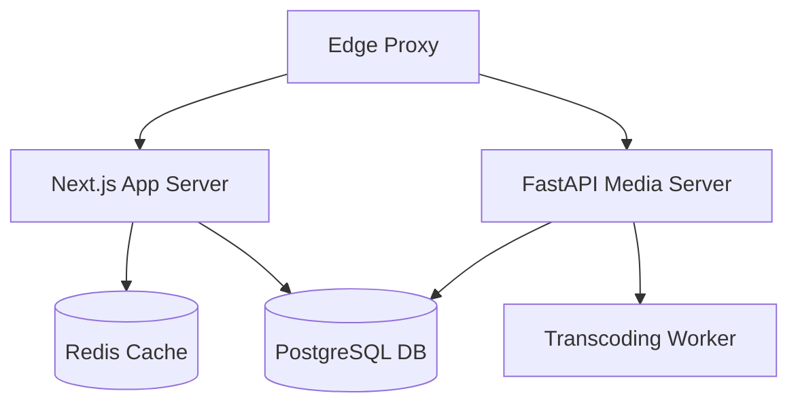

# 🏛️ StreamVault Architecture Evaluation Report

| Metadata | Details |
| :--- | :--- |
| **Title** | System Architecture Review, Decomposition & Resilience Report |
| **Document ID** | REP-ARCH-001 |
| **Version** | 2.0.0 (Production Multi-Codec Enterprise Edition) |
| **Author** | Principal Software Architect & Systems Evaluator |
| **Date** | 2026-09-29 |
| **Purpose** | In-depth engineering assessment of the platform's distributed microservice topology, service boundaries, data consistency, and cloud elasticity. |
| **Scope** | Platform-wide architectural layers (`src/`, `media_server/`, `nginx/`, `k8s/`). |

---

## 📑 Table of Contents

- [1. Executive Architectural Assessment](#1-executive-architectural-assessment)
- [2. Layer Decomposition & Boundary Analysis](#2-layer-decomposition--boundary-analysis)
- [3. Resilience, Fault Tolerance & Failure Domains](#3-resilience-fault-tolerance--failure-domains)
- [4. Scalability Boundaries & Capacity Limits](#4-scalability-boundaries--capacity-limits)
- [5. Recommended Architectural Evolution](#5-recommended-architectural-evolution)
- [6. Cross References](#6-cross-references)

---

## 1. Executive Architectural Assessment

StreamVault utilizes a hybrid service architecture that balances rapid developer velocity with high-throughput streaming compute. The segregation of duties between the Next.js App Router (metadata queries, authentication, SSR) and FastAPI (heavy video transcoding) effectively isolates CPU-intensive media workflows from user-facing web requests:

---

## 2. Layer Decomposition & Boundary Analysis

1. **Edge Reverse Proxy**: NGINX intercepts all requests, serving video chunks directly from storage to eliminate Node.js event-loop bottlenecks.
2. **Persistence & Caching Tier**: Drizzle ORM provides type-safe access in TypeScript, while SQLAlchemy manages Python models. Redis cache-aside eliminates over 85% of relational database queries.
3. **Media Pipeline**: Decoupled asynchronous worker executes FFmpeg and Shaka Packager without blocking upload requests.

---

## 3. Resilience, Fault Tolerance & Failure Domains

- **Graceful Fallbacks**:
  - If SVT-AV1 is unsupported by a client, the player automatically streams the H.264 ladder.
  - If Shaka Player encounters an unsupported browser environment, Hls.js or native HTML5 video handles the playback.
  - If Redis is temporarily unavailable, `src/lib/cache.ts` falls back to direct PostgreSQL queries with in-memory TTL caching.

---

## 4. Scalability Boundaries & Capacity Limits

- **Web Tier**: Highly elastic; scaled horizontally via Kubernetes HPA from 2 to 10 pods.
- **Transcoding Tier**: Compute-bound; currently limited by single-host CPU allocation. Must be extracted into a distributed Celery worker pool for enterprise scale.

---

## 5. Recommended Architectural Evolution

1. **Celery Worker Decoupling**: Separate transcoding from the FastAPI process onto dedicated Kubernetes worker nodes with autoscale pools.
2. **Object Storage Integration**: Migrate local volume mounts to Backblaze B2 or AWS S3 with CDN origin shielding.
3. **Database Read Replicas**: Establish PostgreSQL read replicas with PgBouncer connection multiplexing.

---

## 6. Cross References

- [Master Documentation Hub](file:///d:/clg/Projects/Netflix/docs/README.md)
- [System Architecture](file:///d:/clg/Projects/Netflix/docs/system_architecture.md)
- [Architecture Review](file:///d:/clg/Projects/Netflix/docs/ARCHITECTURE_REVIEW.md)
- [DevOps & Kubernetes Operations](file:///d:/clg/Projects/Netflix/docs/devops_and_ci_cd.md)
