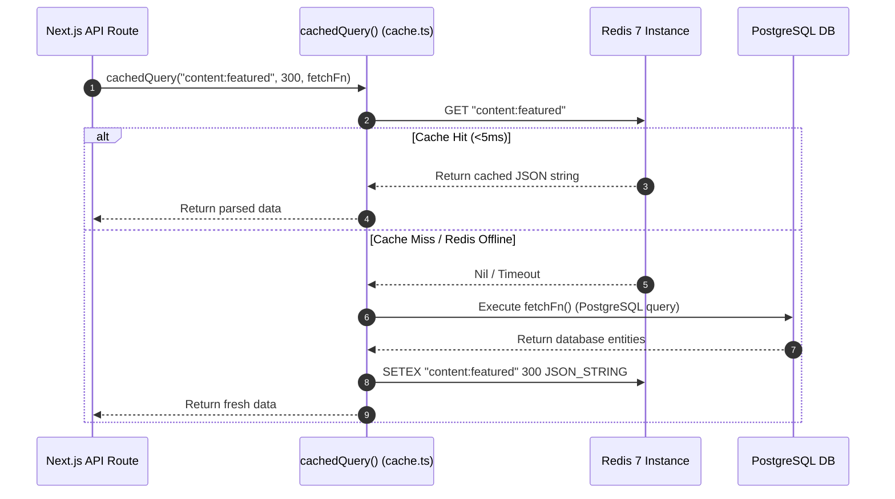

# 🖥️ StreamVault Backend Architecture Specification

| Metadata | Details |
| :--- | :--- |
| **Title** | Backend Services, Runtime Architecture & Middleware Specification |
| **Document ID** | BACK-001 |
| **Version** | 2.0.0 (Production Multi-Codec Enterprise Edition) |
| **Author** | Principal Backend Architect & Distributed Systems Engineer |
| **Date** | 2026-09-29 |
| **Purpose** | Comprehensive technical specification of the dual-engine backend (Next.js Node.js runtime and FastAPI Python runtime), API design patterns, caching tiers, rate limiting, and database connectivity. |
| **Scope** | `src/app/api/`, `src/lib/`, and `media_server/app/`. |

---

## 📑 Table of Contents

- [1. Dual Backend Runtime Topology](#1-dual-backend-runtime-topology)
- [2. Next.js App Router Architecture](#2-nextjs-app-router-architecture)
  - [2.1 API Route Lifecycle & Request Handling](#21-api-route-lifecycle--request-handling)
  - [2.2 Standard API Response Envelopes](#22-standard-api-response-envelopes)
- [3. FastAPI Media Server Runtime](#3-fastapi-media-server-runtime)
  - [3.1 Asynchronous Background Worker Architecture](#31-asynchronous-background-worker-architecture)
  - [3.2 Session & Database Transaction Lifecycle](#32-session--database-transaction-lifecycle)
- [4. Distributed Caching Engine (`src/lib/cache.ts`)](#4-distributed-caching-engine-srclibcachets)
- [5. Distributed Sliding-Window Rate Limiting (`src/lib/rate-limit.ts`)](#5-distributed-sliding-window-rate-limiting-srclibrate-limitts)
- [6. Security & Operational Audit Engine (`src/lib/audit.ts`)](#6-security--operational-audit-engine-srclibauditts)
- [7. Backblaze B2 & Cloudflare CDN Proxy Tier (`src/app/api/b2/`)](#7-backblaze-b2--cloudflare-cdn-proxy-tier-srcappapib2)
- [8. Error Handling & HTTP Status Code Conventions](#8-error-handling--http-status-code-conventions)
- [9. Backend Implementation Gap Analysis & Recommendations](#9-backend-implementation-gap-analysis--recommendations)
- [10. Cross References](#10-cross-references)

---

## 1. Dual Backend Runtime Topology

StreamVault splits backend responsibilities across two specialized runtime environments:

```mermaid
graph TB
    subgraph Client["Client Entry"]
        Browser[Web Browser / API Consumer]
    end

    subgraph ReverseProxy["NGINX Edge Proxy"]
        Proxy[NGINX (Port 80/443)]
    end

    subgraph NodeRuntime["Node.js 22 Runtime (Next.js 16)"]
        NextAuth["/api/auth/* (Authentication & JWT)"]
        NextContent["/api/content/* (Catalog, Slug, Search)"]
        NextWatch["/api/watch/* (Watch History & Progress)"]
        NextAI["/api/recommendations (Hybrid AI Affinity)"]
        NextTelemetry["/api/analytics/playback (QoE Ingestion)"]
        NextMetrics["/api/metrics (Prometheus Exporter)"]
    end

    subgraph PythonRuntime["Python 3.11 Runtime (FastAPI / Uvicorn)"]
        FastAPIUpload["/api/v1/admin/upload (Media Ingestion)"]
        FastAPIJobs["/api/v1/admin/jobs (Transcode Queue State)"]
        FastAPIWorker["Background Worker (FFmpeg / SVT-AV1 / Shaka)"]
    end

    subgraph DataLayer["Persistence & Cache"]
        Redis[(Redis 7)]
        Postgres[(PostgreSQL 16)]
    end

    Browser --> Proxy
    Proxy -->|Default Routes /api/| NodeRuntime
    Proxy -->|Media Admin /api/v1/admin/| PythonRuntime

    NodeRuntime --> Redis
    NodeRuntime --> Postgres

    PythonRuntime --> Postgres
    PythonRuntime --> Redis
```

---

## 2. Next.js App Router Architecture

### 2.1 API Route Lifecycle & Request Handling
Every request to a Next.js App Router route handler (`route.ts`) undergoes a deterministic validation pipeline:
1. **Perimeter Rate Limiting**: The client IP address (`x-forwarded-for`) is extracted and checked against the Redis sliding window. If exceeded, returns HTTP 429.
2. **Session Verification**: `getSessionOrRefresh()` validates the HttpOnly JWT access token. If expired, it transparently validates and rotates the refresh token.
3. **Cache-Aside Interception**: Read endpoints check Redis before querying PostgreSQL.
4. **Response Serialization**: Standardized JSON envelopes ensure consistent consumption by clients.

### 2.2 Standard API Response Envelopes
Implemented in `src/lib/api-response.ts`:

#### Success Envelope:
```json
{
  "success": true,
  "data": { ... }
}
```

#### Error Envelope:
```json
{
  "success": false,
  "error": {
    "message": "Resource not found",
    "code": "NOT_FOUND"
  }
}
```

Standard helper methods:
- `successResponse(data, status = 200)`
- `unauthorizedResponse(message = "Unauthorized")`
- `validationErrorResponse(message)`
- `internalErrorResponse(message = "Internal server error")`

---

## 3. FastAPI Media Server Runtime

### 3.1 Asynchronous Background Worker Architecture
Defined in `media_server/app/main.py` and `media_server/app/worker.py`:
- Ingests video uploads via multipart form data (`file: UploadFile = File(...)`).
- Writes incoming byte streams directly to `uploads/sources/`.
- Inserts an initial record into the `encoding_jobs` PostgreSQL table with `status="pending"`.
- Enqueues the transcoding execution onto FastAPI's `BackgroundTasks` runner:
  ```python
  background_tasks.add_task(process_encoding_job, db, job.id)
  ```
- Frees the HTTP worker thread immediately, returning `200 OK` with the `job_id` within $<50\text{ms}$.

### 3.2 Session & Database Transaction Lifecycle
- SQLAlchemy session dependency:
  ```python
  def get_db():
      db = SessionLocal()
      try:
          yield db
      finally:
          db.close()
  ```
- Any failure in the background pipeline catches the exception, updates `encoding_jobs.status = "failed"`, logs the traceback to `error_message`, and commits the transaction to ensure the failure is visible in the Admin UI.

---

## 4. Distributed Caching Engine (`src/lib/cache.ts`)

The caching layer uses a **Cache-Aside Pattern** with automated in-memory fallback if Redis experiences connection degradation:



---

## 5. Distributed Sliding-Window Rate Limiting (`src/lib/rate-limit.ts`)

Unlike fixed-window limiters that permit double the quota across window boundaries, StreamVault implements a millisecond-precision **Sliding-Window Log** backed by Redis Sorted Sets:

```typescript
const now = Date.now();
const windowStart = now - windowMs;

// Pipeline atomic transaction
const pipeline = redisClient.pipeline();
pipeline.zremrangebyscore(key, 0, windowStart); // Evict timestamps older than window
pipeline.zadd(key, now, `${now}-${Math.random()}`); // Record current request
pipeline.zcard(key); // Count active requests in window
pipeline.pexpire(key, windowMs); // Auto-expire entire set
const results = await pipeline.exec();
const requestCount = results[2][1] as number;

const allowed = requestCount <= max;
```

---

## 6. Security & Operational Audit Engine (`src/lib/audit.ts`)

Audit trails are recorded asynchronously via non-blocking database queries to eliminate latency overhead on mutation endpoints:

```typescript
export async function logAudit({
  userId,
  action,
  targetType,
  targetId,
  ipAddress,
  metadata = {},
}: { ... }) {
  try {
    await db.insert(auditLogs).values({
      userId,
      action,
      targetType,
      targetId,
      ipAddress,
      metadata,
    });
  } catch (err) {
    console.error("[AuditLog Error]:", err);
  }
}
```

Monitored actions:
- `CONTENT_CREATE`, `CONTENT_UPDATE`, `CONTENT_DELETE`
- `USER_ROLE_CHANGE`, `USER_PLAN_UPGRADE`
- `JOB_RETRY`, `JOB_FAILURE`
- `AUTH_LOGIN_SUCCESS`, `AUTH_LOGIN_FAILURE`

---

## 7. Backblaze B2 & Cloudflare CDN Proxy Tier (`src/app/api/b2/`)

The route handler `src/app/api/b2/[...path]/route.ts` provides hybrid edge proxying:
- **Cloud CDN Passthrough**: If `CDN_BASE_URL` (Cloudflare Worker) is configured, redirects requests directly to edge CDN nodes, reducing origin bandwidth.
- **B2 Native Authorization**: Automatically refreshes Backblaze B2 authorization tokens using Application Key ID and Application Key (`src/lib/b2-storage.ts`).
- **On-The-Fly Transcoding Fallback**: If a legacy or non-DASH video file is requested at a lower resolution (`?quality=720p`), spawns a local FFmpeg pipe process streaming directly to the client.

---

## 8. Error Handling & HTTP Status Code Conventions

| Status Code | Meaning | Usage in StreamVault |
| :--- | :--- | :--- |
| **200 OK** | Success | Standard response for successful GET/POST operations. |
| **206 Partial Content** | Partial Content | Byte-range video chunk delivery (`/api/stream/media`). |
| **400 Bad Request** | Validation Failure | Invalid input payload, non-supported video container. |
| **401 Unauthorized** | Authentication Required | Expired or absent access and refresh tokens. |
| **403 Forbidden** | Insufficient Permissions | Regular user attempting admin catalog mutation. |
| **404 Not Found** | Resource Missing | Non-existent slug, missing media segment, deleted user. |
| **429 Too Many Requests** | Rate Limit Exceeded | Client exceeded sliding-window limit tier; includes `Retry-After`. |
| **500 Internal Error** | Server Exception | Uncaught runtime error; sanitized message emitted. |

---

## 9. Backend Implementation Gap Analysis & Recommendations

| Architecture Component | Current Codebase Implementation | Enterprise Scale Recommendation |
| :--- | :--- | :--- |
| **Transcoding Task Worker** | In-process FastAPI `BackgroundTasks` | Standalone Celery or BullMQ worker fleet with Redis Sentinel broker |
| **Database Pool** | Shared single PostgreSQL pool | Connection multiplexing with PgBouncer |
| **Log Management** | Console `console.log()` and Python `logging` | Structured JSON logging aggregated into Winston / Pino / Datadog |
| **Distributed Tracing** | None | OpenTelemetry instrumentation with Jaeger / W3C TraceContext headers |

---

## 10. Cross References

- [Master Documentation Hub](file:///d:/clg/Projects/Netflix/docs/README.md)
- [System Architecture](file:///d:/clg/Projects/Netflix/docs/system_architecture.md)
- [REST API Reference](file:///d:/clg/Projects/Netflix/docs/api_reference.md)
- [Database Architecture & Schema](file:///d:/clg/Projects/Netflix/docs/database_design_and_schema.md)
- [Security Architecture & Audit](file:///d:/clg/Projects/Netflix/docs/security_architecture_and_audit.md)
