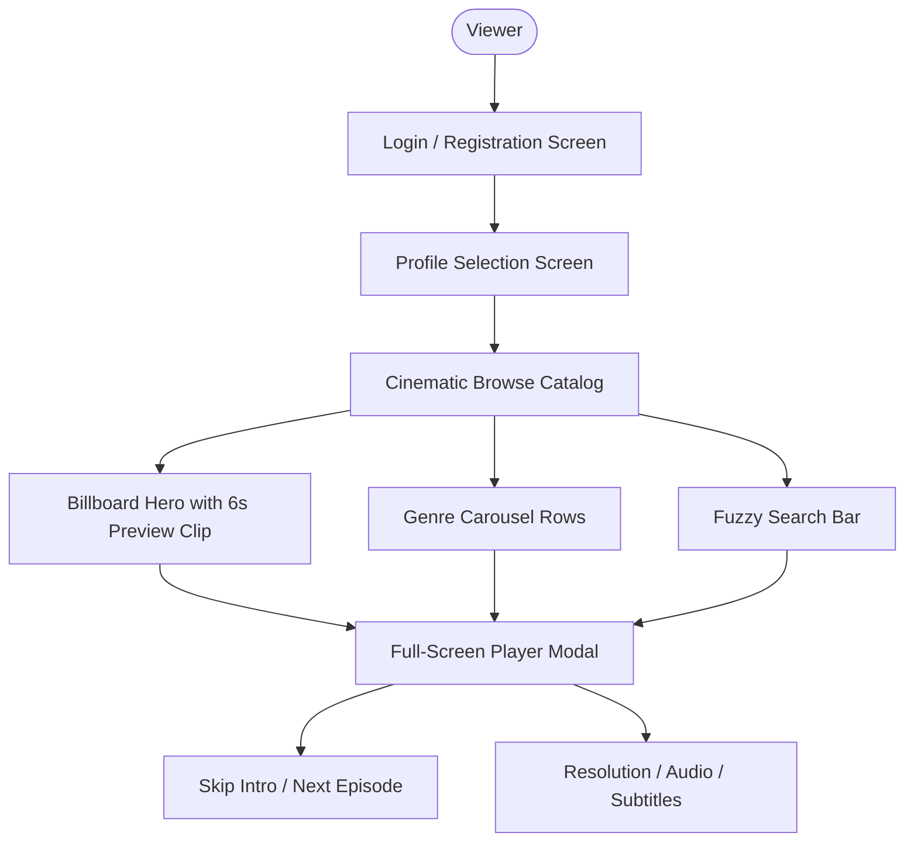

# 📱 StreamVault Client Features & Specifications

| Metadata | Details |
| :--- | :--- |
| **Title** | Client Experience, Feature Specifications, Interaction Models & UI Workflows |
| **Document ID** | CLT-001 |
| **Version** | 2.0.0 (Production Multi-Codec Enterprise Edition) |
| **Author** | Senior Product Manager & Lead UX Engineer |
| **Date** | 2026-09-29 |
| **Purpose** | Comprehensive feature specification covering user workflows, multi-profile management, cinematic browsing, playback interactions, and community engagement. |
| **Scope** | Client web application (`src/app/`, `src/components/`, and `src/store/`). |

---

## 📑 Table of Contents

- [1. User Experience Overview & Visual Philosophy](#1-user-experience-overview--visual-philosophy)
- [2. Identity & Multi-Profile Management](#2-identity--multi-profile-management)
- [3. Cinematic Browse & Billboard Experience](#3-cinematic-browse--billboard-experience)
- [4. Search & Discovery Experience](#4-search--discovery-experience)
- [5. Video Player Interface & Controls](#5-video-player-interface--controls)
  - [5.1 Adaptive Quality Selector](#51-adaptive-quality-selector)
  - [5.2 Multi-Language Audio & Subtitles](#52-multi-language-audio--subtitles)
  - [5.3 Dynamic Interactive Content Markers](#53-dynamic-interactive-content-markers)
  - [5.4 Playback Speed & Picture-in-Picture](#54-playback-speed--picture-in-picture)
- [6. Engagement Features: Watch History, My List, Ratings & Comments](#6-engagement-features-watch-history-my-list-ratings--comments)
- [7. Keyboard Shortcuts & Accessibility (a11y)](#7-keyboard-shortcuts--accessibility-a11y)
- [8. Client Gap Analysis & Recommendations](#8-client-gap-analysis--recommendations)
- [9. Cross References](#9-cross-references)

---

## 1. User Experience Overview & Visual Philosophy

StreamVault provides a distraction-free, cinematic dark mode interface inspired by tier-1 SVOD platforms. High-resolution promotional imagery, subtle micro-animations, and instant video previews engage users immediately upon landing:

---

## 2. Identity & Multi-Profile Management

StreamVault allows multiple members of a household to maintain separate streaming preferences under a single subscription:
- **Up to 5 Profiles per Account**: Each profile maintains independent watch history, personal watchlists, and algorithmic recommendation vectors.
- **Customization**: Viewers select a custom avatar color (`avatar_color`) and emoji icon (`avatar_emoji`).
- **Kids Mode Filtering (`is_kids = true`)**: Restricts the visible catalog strictly to G and PG content, hiding mature television series and films.
- **Instant Profile Switching**: Switch profiles instantly from the navigation dropdown without logging out or re-entering credentials.

---

## 3. Cinematic Browse & Billboard Experience

- **Hero Billboard**: Features the platform's flagship title with wide $16:9$ cinematic artwork, title typography, synopsis, and IMDb star rating.
- **6-Second Video Previews**: Hovering or lingering on the billboard triggers silent background playback of the title's pre-rendered `preview.mp4` clip.
- **Horizontal Carousels**: Segmented by genre (Action, Sci-Fi, Drama, Anime) with responsive smooth-scroll buttons.
- **Hover Card Expansion**: Content cards elevate (`scale: 1.05`) with a 200ms animation, displaying duration, release year, maturity rating badge, and "Quick Play" triggers.

---

## 4. Search & Discovery Experience

- **Debounced Instant Search**: Initiates ranked search queries after 300ms of user keyboard inactivity.
- **Typo-Tolerant Matching**: Employs Levenshtein fuzzy distance matching ($d \le 2$) so misspellings (e.g. `"stranger thngs"` or `"intrestellar"`) still surface the intended titles.
- **Deep Keyword Matching**: Indexes actor names, director names, genre tags, and plot synopses.

---

## 5. Video Player Interface & Controls

### 5.1 Adaptive Quality Selector
Located inside the gear settings menu:
- `Auto (Adaptive)`: Delegates quality selection to Shaka Player's ABR algorithm.
- Manual resolutions: `1080p (Full HD)`, `720p (HD)`, `480p (SD)`, `360p (Data Saver)`.
- Seamless switching occurs without buffer flushes or playback interruption.

### 5.2 Multi-Language Audio & Subtitles
- Dynamic track discovery reads available language streams directly from the manifest.
- Switch between original audio and dub tracks without audio drift.
- Toggle high-contrast WebVTT subtitles with transparent background boxes.

### 5.3 Dynamic Interactive Content Markers
- **Skip Intro**: When playback reaches the title sequence (`introStartTime`), an animated button appears in the upper right. Clicking it advances the player to `introEndTime` with an instant seek.
- **Next Episode / Finish**: When playback reaches `creditsStartTime` (or duration $- 40\text{s}$), a prompt allows viewers to transition to the next episode immediately.

### 5.4 Playback Speed & Picture-in-Picture
- Supports $0.5\times$, $0.75\times$, $1.0\times$ (normal), $1.25\times$, $1.5\times$, and $2.0\times$ speeds with pitch correction.
- Picture-in-Picture (PiP) allows viewers to float video in a resizable window while multitasking.

---

## 6. Engagement Features: Watch History, My List, Ratings & Comments

1. **Continue Watching**:
   - The player periodically sends playback timestamps to `/api/watch/progress`.
   - Returning viewers resume playback from the exact second they left off.
   - Titles are marked completed once playback surpasses 90% of duration.
2. **Watchlist ("My List")**:
   - One-click bookmarking of movies and series to a persistent personal row.
3. **Star Ratings**:
   - Submit 1 to 5-star ratings; heavily influences the hybrid recommendation engine.
4. **Community Comments**:
   - Real-time discussion thread beneath content details.

---

## 7. Keyboard Shortcuts & Accessibility (a11y)

| Key | Action |
| :--- | :--- |
| `Space` / `K` | Toggle Play / Pause |
| `Arrow Left` / `J` | Skip Backward 10 Seconds |
| `Arrow Right` / `L` | Skip Forward 10 Seconds |
| `Arrow Up` | Volume Up 10% |
| `Arrow Down` | Volume Down 10% |
| `M` | Toggle Mute |
| `F` | Toggle Fullscreen |
| `Escape` | Exit Fullscreen / Close Player Modal |

---

## 8. Client Gap Analysis & Recommendations

| Client Feature | Current Implementation State | Production Recommendation |
| :--- | :--- | :--- |
| **Offline Media Downloads** | Missing | Add encrypted IndexedDB Cache API storage for mobile web / PWA |
| **Google Cast / AirPlay** | Missing in UI controls | Add Google Cast Web SDK button to player controls |
| **Audio Description (AD)** | Missing | Demux descriptive audio tracks during FFmpeg pipeline |
| **Closed Caption Styling** | Fixed styling | Allow user customization of font family, font size, and text color |

---

## 9. Cross References

- [Master Documentation Hub](file:///d:/clg/Projects/Netflix/docs/README.md)
- [Playback & Player Engine](file:///d:/clg/Projects/Netflix/docs/playback_engine.md)
- [Frontend Architecture](file:///d:/clg/Projects/Netflix/docs/frontend_architecture.md)
- [REST API Reference](file:///d:/clg/Projects/Netflix/docs/api_reference.md)
