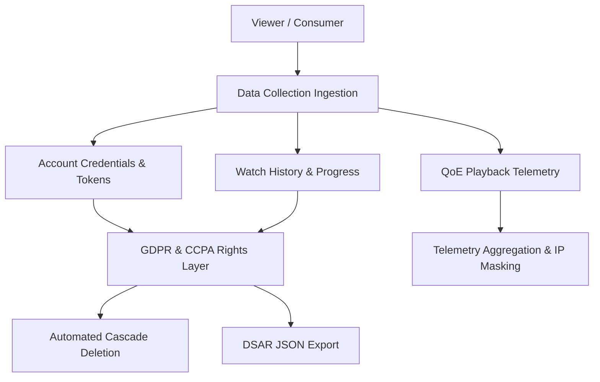
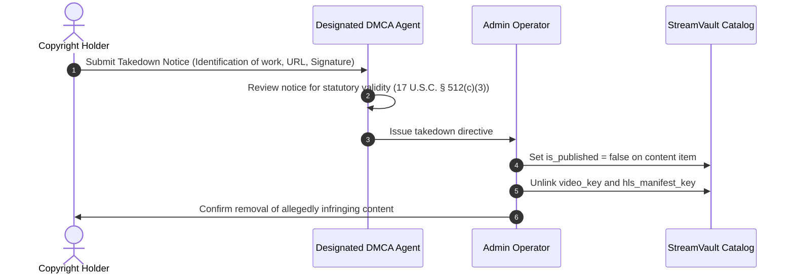

# ⚖️ StreamVault Compliance, Legal & Governance Standards

| Metadata | Details |
| :--- | :--- |
| **Title** | Privacy Policy, Terms of Service, GDPR, CCPA & DMCA Governance Framework |
| **Document ID** | CMP-001 |
| **Version** | 2.0.0 (Production Multi-Codec Enterprise Edition) |
| **Author** | Principal Compliance Engineer & Legal Technology Architect |
| **Date** | 2026-09-29 |
| **Purpose** | Comprehensive legal and regulatory compliance architecture covering user privacy, data protection, copyright infringement takedowns, cookie policies, and community moderation. |
| **Scope** | Platform-wide data collection, storage policies, client interfaces, and administrative operations. |

---

## 📑 Table of Contents

- [1. Regulatory & Privacy Governance Framework](#1-regulatory--privacy-governance-framework)
- [2. Privacy Policy & Data Classification](#2-privacy-policy--data-classification)
- [3. Cookie Policy & Tracking Governance](#3-cookie-policy--tracking-governance)
- [4. GDPR (General Data Protection Regulation) Compliance](#4-gdpr-general-data-protection-regulation-compliance)
  - [4.1 Right to Erasure ("Right to be Forgotten")](#41-right-to-erasure-right-to-be-forgotten)
  - [4.2 Data Subject Access Requests (DSAR)](#42-data-subject-access-requests-dsar)
- [5. CCPA / CPRA Compliance](#5-ccpa--cpra-compliance)
- [6. DMCA Notice & Takedown Governance](#6-dmca-notice--takedown-governance)
- [7. Community Guidelines & Content Moderation Policy](#7-community-guidelines--content-moderation-policy)
- [8. Compliance Gap Analysis & Recommendations](#8-compliance-gap-analysis--recommendations)
- [9. Cross References](#9-cross-references)

---

## 1. Regulatory & Privacy Governance Framework

StreamVault is engineered to comply with major international privacy and digital content regulations:
- **GDPR (Regulation EU 2016/679)**: Regulates processing of personal data for European Union residents.
- **CCPA / CPRA (California Consumer Privacy Act)**: Protects consumer data rights for California residents.
- **DMCA (Digital Millennium Copyright Act)**: Provides legal safe harbor against copyright infringement liabilities.

---

## 2. Privacy Policy & Data Classification

| Data Category | Specific Attributes | Legal Basis | Retention Window | Storage Location |
| :--- | :--- | :--- | :--- | :--- |
| **Identity Data** | Email, bcrypt password hash, plan tier | Contractual Necessity | Duration of account lifecycle | PostgreSQL `users` table |
| **Profile Data** | Profile name, avatar color, avatar emoji, kids mode | Legitimate Interest | Purged on profile deletion | PostgreSQL `profiles` table |
| **Engagement Data**| Watch history, watchlist bookmarks, ratings, comments | Consent / Legitimate Interest | Purged on profile deletion | PostgreSQL `watch_history`, `my_list` |
| **Telemetry (QoE)**| Startup latency, buffer stalls, bitrate, user agent | Legitimate Interest (QoE Tuning) | 90 days rolling retention | PostgreSQL `playback_telemetry` |
| **Security Audits**| Actor user ID, action, origin IP address | Legal Obligation / Security | 1 year immutable retention | PostgreSQL `audit_logs` |

---

## 3. Cookie Policy & Tracking Governance

StreamVault operates under a **Strict Necessity Cookie Policy**:
1. `access_token`: Short-lived (15 minutes), HttpOnly, SameSite=Lax. Essential for session state.
2. `refresh_token`: 30-day cryptographically hashed token, HttpOnly, SameSite=Strict. Essential for token rotation.
- **Zero Third-Party Advertising Cookies**: The platform embeds no third-party tracking pixels (e.g. Meta Pixel, Google AdSense, or data broker cookies). Consequently, no invasive cookie consent banners are required under ePrivacy Directive exemptions for strictly necessary session management.

---

## 4. GDPR (General Data Protection Regulation) Compliance

### 4.1 Right to Erasure ("Right to be Forgotten" - Article 17)
StreamVault implements instantaneous, cascading data erasure. When a user requests account termination or profile deletion:
- Deleting a `users` record triggers database `ON DELETE CASCADE` constraints across:
  - `profiles`
  - `refresh_tokens`
  - `watch_history`
  - `my_list`
  - `ratings`
  - `comments`
- In `audit_logs` and `playback_telemetry`, the foreign keys are set to `NULL` (`ON DELETE SET NULL`) preserving anonymized operational counters without retaining personally identifiable information (PII).

### 4.2 Data Subject Access Requests (DSAR - Article 15)
- All user information is organized under the single relational parent `users.id`.
- Operations teams can generate a complete machine-readable JSON export of a user's profile history, comments, ratings, and watch logs via a standard query against the relational tables.

---

## 5. CCPA / CPRA Compliance

- **No Sale of Personal Data**: StreamVault does not sell, rent, or trade personal viewer information to data brokers or advertising exchanges.
- **Opt-Out Rights**: Because no third-party cross-context behavioral tracking is performed, the platform complies with "Do Not Sell or Share My Personal Information" requirements by default.

---

## 6. DMCA Notice & Takedown Governance

StreamVault adheres to 17 U.S.C. § 512 notice and takedown guidelines:

Designated DMCA Agent Contact:
- **Agent Name**: StreamVault Legal Department
- **Email**: `dmca-agent@streamvault.example.com`
- **Takedown SLA**: Expedited removal within **24 business hours** of receiving a statutorily compliant notice.

---

## 7. Community Guidelines & Content Moderation Policy

1. **User Comments**:
   - Comments must remain constructive, civil, and related to the film or television episode.
   - Zero tolerance for hate speech, harassment, spam, spoilers without warning, or commercial advertising.
2. **Ratings Policy**:
   - Ratings must reflect genuine viewer opinion; coordinated review-bombing campaigns are subject to moderation review.
3. **Enforcement Actions**:
   - Administrators reserve the authority to delete offending comments and revoke commenting privileges from offending user accounts.

---

## 8. Compliance Gap Analysis & Recommendations

| Compliance Dimension | Current Implementation State | Production Recommendation |
| :--- | :--- | :--- |
| **Self-Service DSAR Export**| Admin manual database query | Build a one-click "Download My Data" button in `/account` |
| **Self-Service Deletion** | Admin manual account deletion | Build a "Delete My Account" flow in `/account` with password confirmation |
| **Automated DMCA Queue** | Manual email processing | Build an authenticated DMCA claim submission and tracking portal |
| **IP Address Masking** | Plain text IPv4/IPv6 logged in telemetry | Apply SHA-256 one-way hashing or subnet truncation (`/24`) to telemetry IPs |

---

## 9. Cross References

- [Master Documentation Hub](file:///d:/clg/Projects/Netflix/docs/README.md)
- [Security Architecture & Audit](file:///d:/clg/Projects/Netflix/docs/security_architecture_and_audit.md)
- [Database Architecture & Schema](file:///d:/clg/Projects/Netflix/docs/database_design_and_schema.md)
- [Admin Operations Guide](file:///d:/clg/Projects/Netflix/docs/admin_operations_guide.md)
