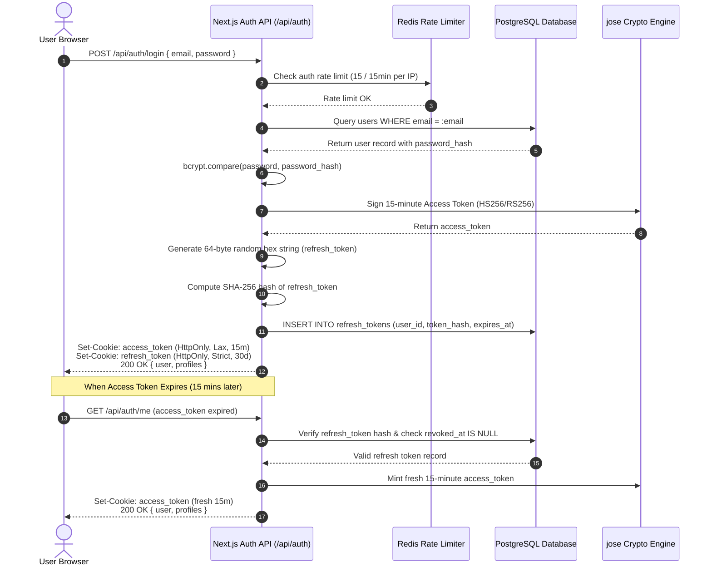
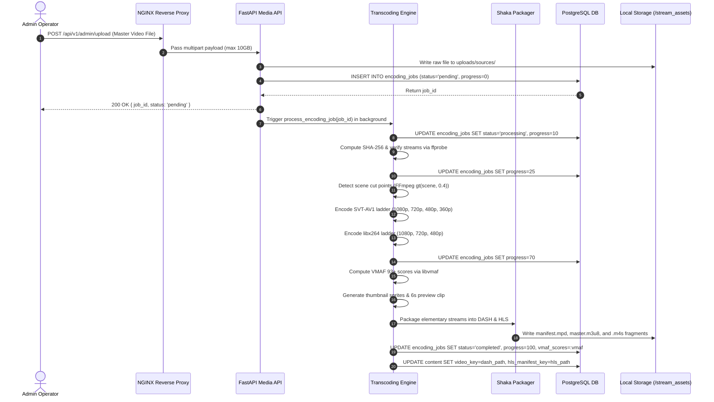
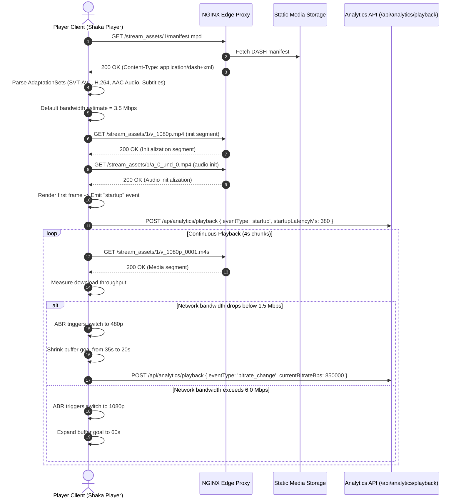
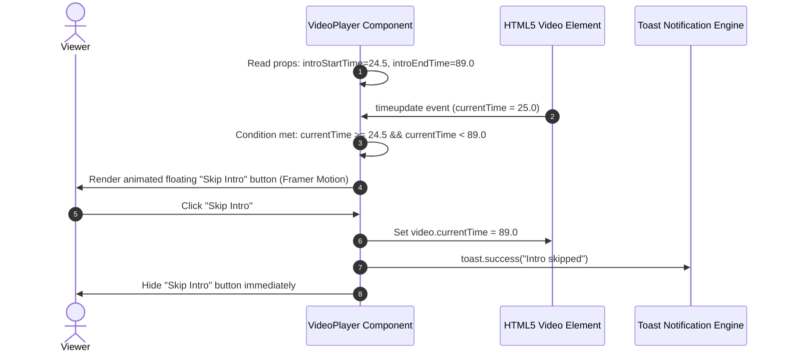
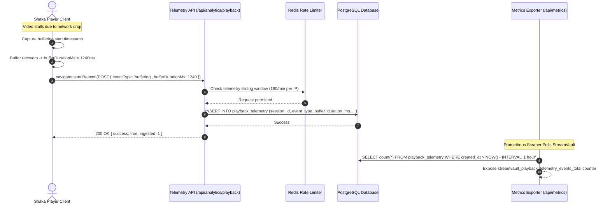
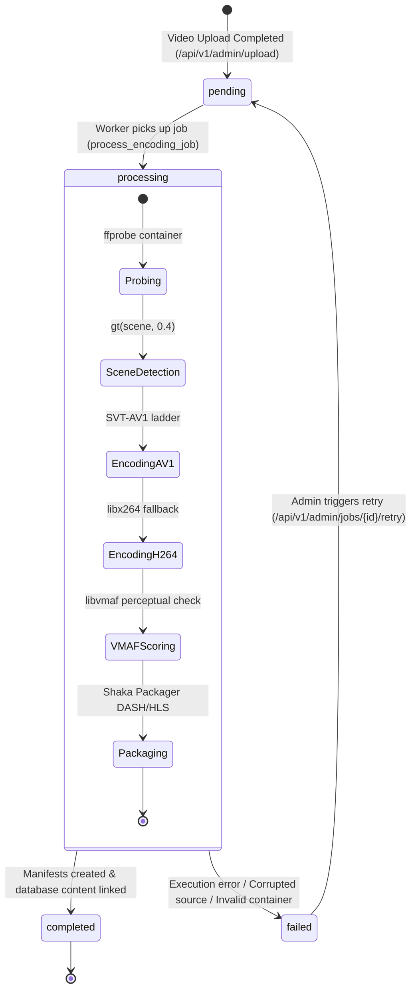
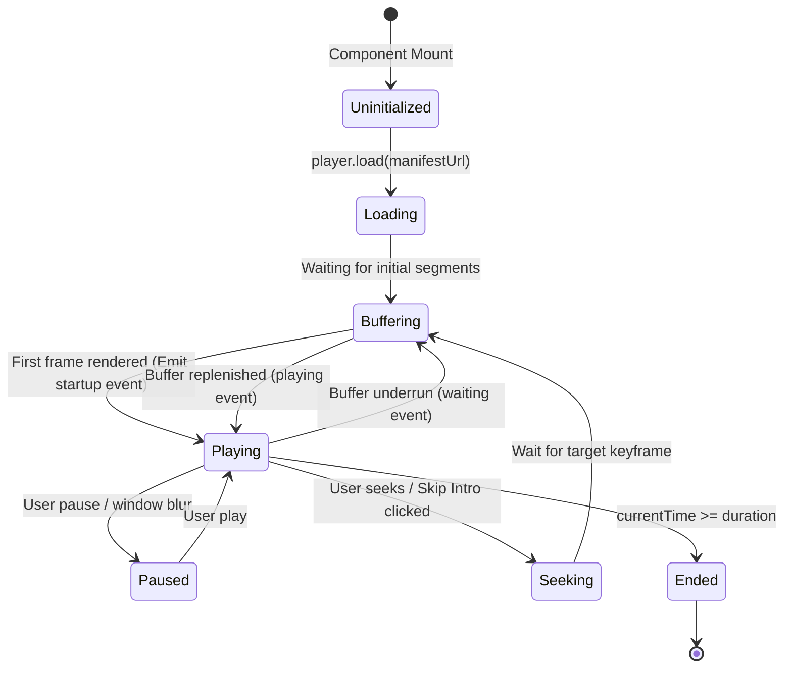
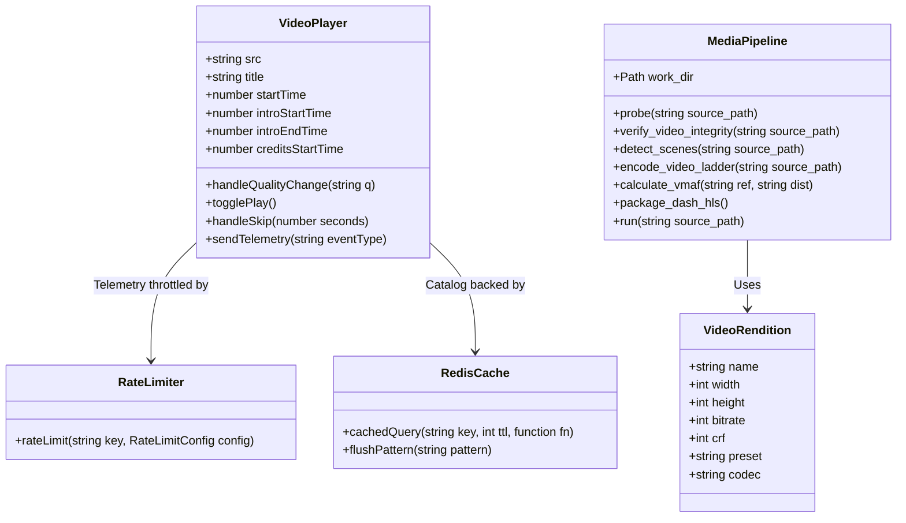
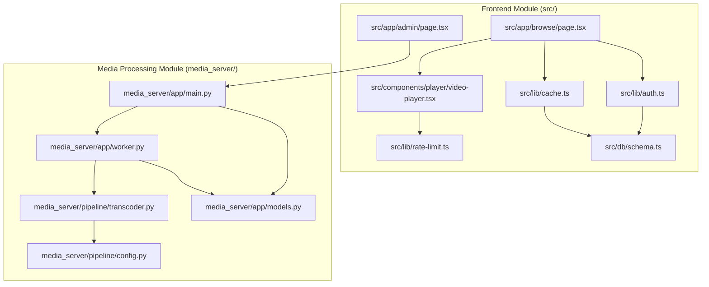

# 🔄 StreamVault Data Flows, Control Flows & Sequence Diagrams

| Metadata | Details |
| :--- | :--- |
| **Title** | StreamVault Data Flows, Sequences & State Transitions |
| **Document ID** | ARCH-002 |
| **Version** | 2.0.0 (Production Multi-Codec Enterprise Edition) |
| **Author** | Principal Software Architect & Lead Systems Modeler |
| **Date** | 2026-09-29 |
| **Purpose** | Visual and technical specification of system interaction protocols, end-to-end sequence diagrams, state machines, and data lifecycles. |
| **Scope** | Core operational flows including authentication, upload and transcoding pipeline, adaptive media playback, client telemetry ingestion, and interactive content markers. |

---

## 📑 Table of Contents

- [1. End-to-End Data Lifecycle](#1-end-to-end-data-lifecycle)
- [2. System Interaction Sequence Diagrams](#2-system-interaction-sequence-diagrams)
  - [2.1 Authentication & Token Rotation Sequence](#21-authentication--token-rotation-sequence)
  - [2.2 Ingestion & Asynchronous Transcoding Sequence](#22-ingestion--asynchronous-transcoding-sequence)
  - [2.3 Adaptive Playback & Manifest Negotiation Sequence](#23-adaptive-playback--manifest-negotiation-sequence)
  - [2.4 Interactive Content Marker ("Skip Intro") Sequence](#24-interactive-content-marker-skip-intro-sequence)
  - [2.5 Real-Time QoE Telemetry Ingestion Sequence](#25-real-time-qoe-telemetry-ingestion-sequence)
- [3. System State Machines](#3-system-state-machines)
  - [3.1 Encoding Job State Lifecycle](#31-encoding-job-state-lifecycle)
  - [3.2 Video Player Client State Lifecycle](#32-video-player-client-state-lifecycle)
- [4. Class & Component Relationship Diagram](#4-class--component-relationship-diagram)
- [5. Package & Module Dependency Diagram](#5-package--module-dependency-diagram)
- [6. Gap Analysis & Recommendations](#6-gap-analysis--recommendations)
- [7. Cross References](#7-cross-references)

---

## 1. End-to-End Data Lifecycle

Data in StreamVault traverses four distinct lifecycles:
1. **Catalog & Metadata**: Ingested via Admin routes, indexed in PostgreSQL, cached in Redis with TTLs (120s–300s), and rendered to clients via Next.js SSR.
2. **Media Stream Segments**: Uploaded as master files, verified via SHA-256, encoded into multi-codec elementary streams, fragmented into 4-second `.m4s` chunks, packaged with DASH/HLS manifests, and served through NGINX byte-range caching.
3. **Session & Security State**: Stateless JWTs issued to HttpOnly cookies, refresh tokens hashed with SHA-256 and stored in the database, with rate limit sliding counters tracked in Redis sorted sets.
4. **Observability & QoE Telemetry**: Emitted asynchronously from client browsers via `navigator.sendBeacon`, validated against sliding rate limits, persisted in `playback_telemetry`, and aggregated into `/api/metrics` Prometheus counters.

---

## 2. System Interaction Sequence Diagrams

### 2.1 Authentication & Token Rotation Sequence

---

### 2.2 Ingestion & Asynchronous Transcoding Sequence

---

### 2.3 Adaptive Playback & Manifest Negotiation Sequence

---

### 2.4 Interactive Content Marker ("Skip Intro") Sequence

---

### 2.5 Real-Time QoE Telemetry Ingestion Sequence

---

## 3. System State Machines

### 3.1 Encoding Job State Lifecycle

### 3.2 Video Player Client State Lifecycle

---

## 4. Class & Component Relationship Diagram

---

## 5. Package & Module Dependency Diagram

---

## 6. Gap Analysis & Recommendations

| Interaction Flow | Current Implementation | Production Recommendation |
| :--- | :--- | :--- |
| **Transcode Dispatch** | FastAPI `BackgroundTasks` executing within the web process | Distributed Celery / Redis queue worker pool with task persistence |
| **Telemetry Ingest** | Synchronous relational row insert on each beacon | Fire-and-forget ingestion to Kafka topic with micro-batched persistence |
| **Quality Switching** | Track selection via Shaka API | Predictive ABR combining player buffer depth and device compute metrics |
| **Resume Playback** | Debounced POST to `/api/watch/progress` | WebSocket or Server-Sent Events (SSE) state synchronization across multiple screens |

---

## 7. Cross References

- [Master Documentation Hub](file:///d:/clg/Projects/Netflix/docs/README.md)
- [System Architecture](file:///d:/clg/Projects/Netflix/docs/system_architecture.md)
- [Video Transcoding Pipeline](file:///d:/clg/Projects/Netflix/docs/video_streaming_pipeline.md)
- [Playback & Player Engine](file:///d:/clg/Projects/Netflix/docs/playback_engine.md)
- [Database Architecture & Schema](file:///d:/clg/Projects/Netflix/docs/database_design_and_schema.md)
- [REST API Reference](file:///d:/clg/Projects/Netflix/docs/api_reference.md)
