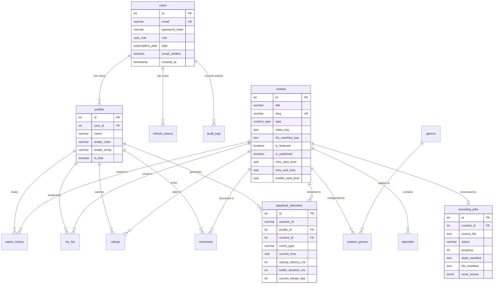

# 🗄️ StreamVault Database Design & Schema Specification

| Metadata | Details |
| :--- | :--- |
| **Title** | Relational Database Architecture, Schema Specification & Indexing Strategy |
| **Document ID** | DB-001 |
| **Version** | 2.0.0 (Production Multi-Codec Enterprise Edition) |
| **Author** | Principal Database Architect & Data Systems Engineer |
| **Date** | 2026-09-29 |
| **Purpose** | Authoritative technical specification of the PostgreSQL relational schema, Drizzle ORM mappings, SQLAlchemy 2.0 models, indexing strategies, normalization standards, and scaling strategies. |
| **Scope** | `src/db/schema.ts`, `src/db/index.ts`, and `media_server/app/models.py`. |

---

## 📑 Table of Contents

- [1. Database Technology & ORM Architecture](#1-database-technology--orm-architecture)
- [2. Complete Entity-Relationship (ER) Diagram](#2-complete-entity-relationship-er-diagram)
- [3. Table Specifications & Column Dictionaries](#3-table-specifications--column-dictionaries)
  - [3.1 Identity & Access (`users`, `profiles`, `refresh_tokens`)](#31-identity--access-users-profiles-refresh_tokens)
  - [3.2 Content Catalog (`genres`, `content`, `content_genres`, `episodes`)](#32-content-catalog-genres-content-content_genres-episodes)
  - [3.3 User Engagement (`watch_history`, `my_list`, `ratings`, `comments`)](#33-user-engagement-watch_history-my_list-ratings-comments)
  - [3.4 Media Operations & Telemetry (`encoding_jobs`, `playback_telemetry`, `audit_logs`)](#34-media-operations--telemetry-encoding_jobs-playback_telemetry-audit_logs)
- [4. Indexing Strategy & Performance Tuning](#4-indexing-strategy--performance-tuning)
- [5. Relational Normalization & Integrity Constraints](#5-relational-normalization--integrity-constraints)
- [6. Dual-ORM Synchronization (Drizzle & SQLAlchemy)](#6-dual-orm-synchronization-drizzle--sqlalchemy)
- [7. Migration & Backup Runbooks](#7-migration--backup-runbooks)
- [8. Partitioning & High-Scale Storage Recommendations](#8-partitioning--high-scale-storage-recommendations)
- [9. Cross References](#9-cross-references)

---

## 1. Database Technology & ORM Architecture

StreamVault utilizes **PostgreSQL 16 Alpine** (with support for Neon Serverless PostgreSQL). The database access layer is designed with a synchronized dual-ORM strategy:
1. **Drizzle ORM (`src/db/schema.ts`)**: Used by the Next.js Node.js runtime for ultra-low overhead, type-safe queries, fast serialization, and schema management via `drizzle-kit`.
2. **SQLAlchemy 2.0 (`media_server/app/models.py`)**: Used by the FastAPI Python media engine to manage `encoding_jobs` and update content manifest keys.

---

## 2. Complete Entity-Relationship (ER) Diagram



---

## 3. Table Specifications & Column Dictionaries

### 3.1 Identity & Access (`users`, `profiles`, `refresh_tokens`)

#### `users`
| Column | Type | Constraints | Description |
| :--- | :--- | :--- | :--- |
| `id` | `serial` | `PRIMARY KEY` | Unique account identifier. |
| `email` | `varchar(255)` | `NOT NULL, UNIQUE` | Normalized login email address. |
| `password_hash`| `varchar(255)` | `NOT NULL` | bcrypt hash (12 salt rounds). |
| `role` | `user_role` enum | `DEFAULT 'user'` | Role: `'user'` or `'admin'`. |
| `plan` | `subscription_plan` | `DEFAULT 'basic'` | Plan: `'basic'`, `'standard'`, `'premium'`. |
| `email_verified`| `boolean`| `DEFAULT false` | Email verification flag. |
| `reset_token` | `varchar(255)` | `NULLABLE` | Expiring password reset secret. |
| `reset_token_expiry`| `timestamp`| `NULLABLE` | Expiration timestamp for reset token. |
| `created_at` | `timestamp` | `NOT NULL, DEFAULT NOW()` | Account creation timestamp. |
| `updated_at` | `timestamp` | `NOT NULL, DEFAULT NOW()` | Account modification timestamp. |

#### `profiles`
| Column | Type | Constraints | Description |
| :--- | :--- | :--- | :--- |
| `id` | `serial` | `PRIMARY KEY` | Unique profile identifier. |
| `user_id` | `integer` | `FK(users.id) ON DELETE CASCADE` | Parent user account. |
| `name` | `varchar(100)` | `NOT NULL` | Display name of the viewer. |
| `avatar_color` | `varchar(20)` | `DEFAULT '#E50914'` | Theme color of the profile avatar. |
| `avatar_emoji` | `varchar(10)` | `DEFAULT '🎬'` | Profile icon emoji. |
| `is_kids` | `boolean` | `DEFAULT false` | Restricts catalog to PG/G content. |

#### `refresh_tokens`
| Column | Type | Constraints | Description |
| :--- | :--- | :--- | :--- |
| `id` | `serial` | `PRIMARY KEY` | Token record ID. |
| `user_id` | `integer` | `FK(users.id) ON DELETE CASCADE` | Linked user account. |
| `token_hash` | `varchar(255)` | `NOT NULL` | SHA-256 hash of raw 64-byte token. |
| `expires_at` | `timestamp` | `NOT NULL` | Absolute token expiration date (30d).|
| `revoked_at` | `timestamp` | `NULLABLE` | Timestamp when revoked by logout. |

---

### 3.2 Content Catalog (`genres`, `content`, `content_genres`, `episodes`)

#### `content`
| Column | Type | Constraints | Description |
| :--- | :--- | :--- | :--- |
| `id` | `serial` | `PRIMARY KEY` | Catalog item ID. |
| `title` | `varchar(255)` | `NOT NULL` | Film or series title. |
| `slug` | `varchar(255)` | `NOT NULL, UNIQUE` | SEO-friendly URL slug. |
| `description` | `text` | `NULLABLE` | Synopsis summary. |
| `type` | `content_type` enum | `DEFAULT 'movie'` | Item type: `'movie'` or `'series'`. |
| `release_year` | `integer` | `NULLABLE` | Theatrical release year. |
| `maturity_rating`| `varchar(10)`| `DEFAULT 'PG-13'` | Rating: TV-MA, PG-13, R, G. |
| `duration` | `integer` | `NULLABLE` | Total duration in minutes. |
| `backdrop_url` | `text` | `NULLABLE` | Wide cinematic billboard image. |
| `poster_url` | `text` | `NULLABLE` | Vertical card poster. |
| `video_key` | `text` | `NULLABLE` | MPEG-DASH manifest path (`manifest.mpd`).|
| `hls_manifest_key`| `text` | `NULLABLE` | HLS master playlist path (`master.m3u8`). |
| `is_featured` | `boolean` | `DEFAULT false` | Displayed on browse billboard. |
| `is_published` | `boolean` | `DEFAULT true` | Public catalog visibility flag. |
| `cast` | `jsonb` | `DEFAULT '[]'` | Actor name array `["Actor A"]`. |
| `directors` | `jsonb` | `DEFAULT '[]'` | Director array `["Director B"]`. |
| `tags` | `jsonb` | `DEFAULT '[]'` | Semantic keywords. |
| `imdb_rating` | `real` | `NULLABLE` | Critic / IMDb rating score. |
| `total_seasons` | `integer` | `NULLABLE` | Season count (for series). |
| `intro_start_time`| `real`| `NULLABLE` | Skip Intro start in seconds. |
| `intro_end_time` | `real` | `NULLABLE` | Skip Intro end in seconds. |
| `credits_start_time`| `real`| `NULLABLE` | End credits start in seconds. |
| `chapters` | `jsonb` | `DEFAULT '[]'` | `[{ title: string, startTime: number }]`.|

---

### 3.3 User Engagement (`watch_history`, `my_list`, `ratings`, `comments`)

#### `watch_history`
Tracks exact playback offsets per profile to enable seamless "Continue Watching":
- Columns: `id`, `profile_id`, `content_id`, `episode_id`, `progress_seconds`, `total_seconds`, `completed`, `updated_at`.
- Unique Compound Index: Optimizes lookups by (`profile_id`, `content_id`).

#### `ratings`
- Columns: `id`, `profile_id`, `content_id`, `score` (1 to 5), `created_at`, `updated_at`.
- Constraint: `UNIQUE (profile_id, content_id)` (one rating per content per profile).

#### `comments`
- Columns: `id`, `profile_id`, `content_id`, `text`, `created_at`, `updated_at`.

---

### 3.4 Media Operations & Telemetry (`encoding_jobs`, `playback_telemetry`, `audit_logs`)

#### `encoding_jobs`
- Columns: `id`, `content_id`, `source_file`, `status` (`pending`, `processing`, `completed`, `failed`), `progress` (0–100), `dash_manifest`, `hls_manifest`, `vmaf_scores` (JSONB), `error_message`, `created_at`, `updated_at`.

#### `playback_telemetry`
- Columns: `id`, `session_id`, `profile_id`, `content_id`, `event_type` (`startup`, `buffering`, `bitrate_change`, `seek`, `error`, `heartbeat`), `current_time`, `startup_latency_ms`, `buffer_duration_ms`, `current_bitrate_bps`, `current_resolution`, `dropped_frames`, `player_engine`, `user_agent`, `error_message`, `created_at`.

#### `audit_logs`
- Columns: `id`, `user_id`, `action`, `target_type`, `target_id`, `ip_address`, `metadata` (JSONB), `created_at`.

---

## 4. Indexing Strategy & Performance Tuning

StreamVault applies specialized B-Tree and Composite indexing patterns:

| Table | Index Name | Indexed Columns | Justification |
| :--- | :--- | :--- | :--- |
| `users` | `users_email_idx` | `email` (Unique) | Instant $O(1)$ login lookup. |
| `content` | `content_slug_idx` | `slug` (Unique) | Routing and detail page SSR lookup. |
| `content` | `content_type_idx` | `type` | Fast filtering between movies and series. |
| `content` | `content_featured_idx`| `isFeatured` | Instant retrieval of the billboard hero item. |
| `content_genres` | `content_genres_content_idx`| `content_id` | Join acceleration for catalog listing. |
| `content_genres` | `content_genres_genre_idx`| `genre_id` | Fast genre carousel filtering. |
| `ratings` | `ratings_profile_content_idx`| `profile_id, content_id` (Unique)| Prevents duplicate ratings and speeds profile lookups. |
| `my_list` | `my_list_unique_idx` | `profile_id, content_id` (Unique)| Fast toggle verification. |
| `playback_telemetry`| `telemetry_session_idx`| `session_id` | Groups session lifecycle events. |
| `playback_telemetry`| `telemetry_event_type_idx`| `event_type` | Aggregates buffering stalls vs startup events. |
| `playback_telemetry`| `telemetry_created_at_idx`| `created_at` | Prometheus sliding 1-hour window query optimization. |

---

## 5. Relational Normalization & Integrity Constraints

1. **Third Normal Form (3NF)**:
   - All non-key attributes are dependent solely on the primary key.
   - Many-to-many relationships (e.g. Content to Genres) are decoupled into junction tables (`content_genres`).
2. **Referential Cascades**:
   - `ON DELETE CASCADE` is applied to `profiles`, `refresh_tokens`, `watch_history`, `my_list`, `ratings`, and `comments` when parent records (`users` or `content`) are purged.
   - `ON DELETE SET NULL` is applied to `encoding_jobs.content_id` and `audit_logs.user_id` to preserve operational and audit records even if entities are deleted.

---

## 6. Dual-ORM Synchronization (Drizzle & SQLAlchemy)

To avoid schema drift between TypeScript and Python:
- The authoritative single source of truth is `src/db/schema.ts`.
- `media_server/app/models.py` matches table names, column names, nullability constraints, and foreign key relationships.

---

## 7. Migration & Backup Runbooks

### 7.1 Schema Push & Migration
```bash
# Push schema changes to active database
npx drizzle-kit push

# Generate migration SQL script
npx drizzle-kit generate
```

### 7.2 Automated Backup Runbook
```bash
# Dump complete database with data and schemas
pg_dump -U postgres -h localhost -d netflix -F c -b -v -f netflix_backup_$(date +%Y%m%d).dump

# Restore dump to target database
pg_restore -U postgres -h localhost -d netflix -v netflix_backup_20260929.dump
```

---

## 8. Partitioning & High-Scale Storage Recommendations

| Table | Volume Growth | Production Scaling Recommendation |
| :--- | :--- | :--- |
| `playback_telemetry` | High (~10M rows/month) | Implement PostgreSQL Declarative Range Partitioning by `created_at` (monthly partitions) |
| `watch_history` | Medium (~2M rows/month) | Hash partition by `profile_id` across 8 sub-tables to isolate concurrent write loads |
| `audit_logs` | Low-Medium | Auto-archive partitions older than 90 days to cold S3/Glacier parquet storage |

---

## 9. Cross References

- [Master Documentation Hub](file:///d:/clg/Projects/Netflix/docs/README.md)
- [System Architecture](file:///d:/clg/Projects/Netflix/docs/system_architecture.md)
- [REST API Reference](file:///d:/clg/Projects/Netflix/docs/api_reference.md)
- [Security Architecture & Audit](file:///d:/clg/Projects/Netflix/docs/security_architecture_and_audit.md)
- [DevOps & Database Backups](file:///d:/clg/Projects/Netflix/docs/devops_and_ci_cd.md)
