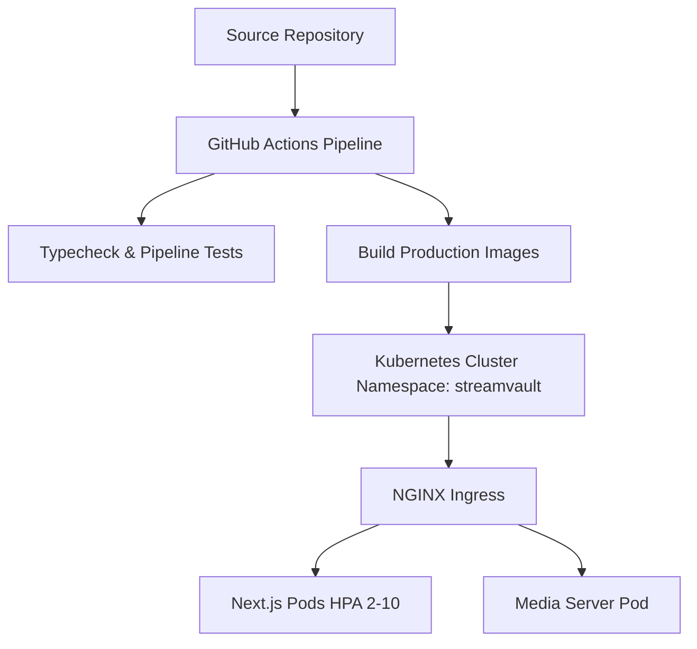

# 🚀 StreamVault Deployment, Operations & Cloud Infrastructure Report

| Metadata | Details |
| :--- | :--- |
| **Title** | Production Operations, Kubernetes Manifests, CI/CD Pipeline & Recovery Audit |
| **Document ID** | REP-DEP-001 |
| **Version** | 2.0.0 (Production Multi-Codec Enterprise Edition) |
| **Author** | Principal DevOps Engineer & Cloud Infrastructure Architect |
| **Date** | 2026-09-29 |
| **Purpose** | Comprehensive audit of production deployment configurations, container images, CI/CD automation, and disaster recovery preparedness. |
| **Scope** | Platform deployment assets (`docker-compose.yml`, `k8s/`, `.github/workflows/ci.yml`). |

---

## 📑 Table of Contents

- [1. Executive Operations Summary](#1-executive-operations-summary)
- [2. Multi-Container Orchestration Audit](#2-multi-container-orchestration-audit)
- [3. Kubernetes Production Manifest Review](#3-kubernetes-production-manifest-review)
- [4. CI/CD Automated Workflow Assessment](#4-cicd-automated-workflow-assessment)
- [5. Disaster Recovery & Rollback Preparedness](#5-disaster-recovery--rollback-preparedness)
- [6. Operational Recommendations](#6-operational-recommendations)
- [7. Cross References](#7-cross-references)

---

## 1. Executive Operations Summary

StreamVault is fully automated for both local containerized execution and enterprise cloud deployment. The infrastructure is standardized around multi-container Docker Compose for developer agility and Kubernetes manifests with HorizontalPodAutoscalers (HPA) for production scaling:



---

## 2. Multi-Container Orchestration Audit

Configured in `docker-compose.yml`:
- **Services Defined**: `postgres`, `redis`, `media-server`, `client-admin`, `nginx`.
- **Health Checks**: PostgreSQL uses `pg_isready -U postgres` with 5-second retries; dependent containers wait for healthy database state before starting.
- **Volume Mounts**: Isolated storage for database (`pgdata`), uploads (`uploads/`), and stream chunks (`/public/stream_assets/`).

---

## 3. Kubernetes Production Manifest Review

Configured in `k8s/`:
- **`namespace.yaml`**: Dedicated `streamvault` isolation boundary.
- **`configmap.yaml`**: Centralized non-sensitive configuration values.
- **`client-admin.yaml`**: Deploys the web application with:
  - 2 baseline replicas.
  - Rolling updates (`maxSurge: 1`, `maxUnavailable: 0`).
  - Liveness and readiness probes hitting `/api/health`.
  - HorizontalPodAutoscaler scaling pods 2 to 10 based on CPU (75%) and memory (80%).
- **`media-server.yaml`**: Deploys the FastAPI transcoding service with PersistentVolumeClaim storage.
- **`ingress.yaml`**: Routes traffic with TLS termination, byte-range caching, and CORS headers.

---

## 4. CI/CD Automated Workflow Assessment

Defined in `.github/workflows/ci.yml`:
- **Triggers**: Executed on all pull requests and pushes to `main`.
- **Automated Validation**:
  1. `npm run typecheck`: Validates complete TypeScript compilation.
  2. `python -m unittest test_pipeline.py`: Executes media pipeline test suite.
  3. Parallel Docker image builds for both web client and media server containers.

---

## 5. Disaster Recovery & Rollback Preparedness

- **Rolling Rollback Command**:
  ```bash
  kubectl rollout undo deployment/streamvault-client-admin -n streamvault
  ```
- **Database Backup**: Standard PostgreSQL `pg_dump` binary snapshots.
- **Stateless Web Tier**: Zero session loss during rolling pod restarts due to cookie-based JWT architecture.

---

## 6. Operational Recommendations

1. **Centralized Logging Daemon**: Deploy FluentBit / Promtail forwarding container stdout/stderr to Loki or Datadog.
2. **Grafana Dashboards**: Commit pre-built dashboard JSON configurations importing `/api/metrics` Prometheus exposition.
3. **Secret Store Integration**: Transition from static Kubernetes secrets to HashiCorp Vault or AWS Secrets Manager.

---

## 7. Cross References

- [Master Documentation Hub](file:///d:/clg/Projects/Netflix/docs/README.md)
- [DevOps & CI/CD Guide](file:///d:/clg/Projects/Netflix/docs/devops_and_ci_cd.md)
- [Production Readiness Report](file:///d:/clg/Projects/Netflix/docs/PRODUCTION_READINESS_REPORT.md)
- [Deployment Guide](file:///d:/clg/Projects/Netflix/docs/deployment_guide.md)
