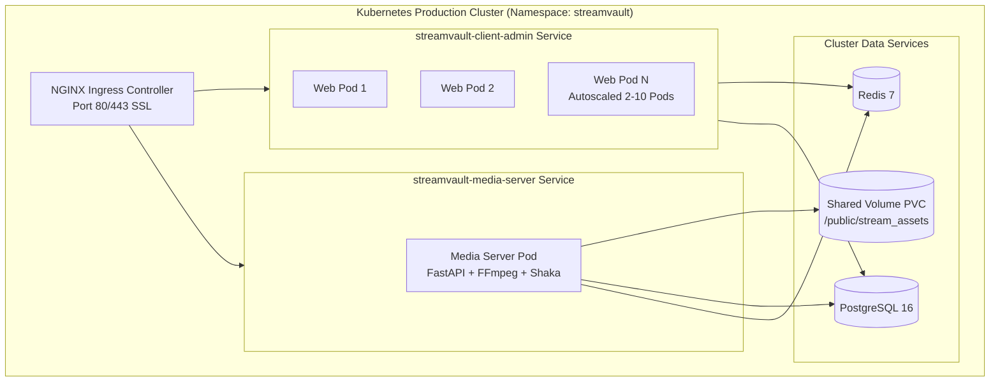
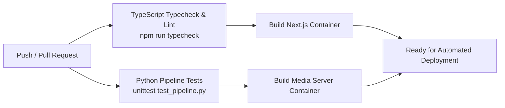

# 🚀 StreamVault DevOps, CI/CD & Operations Guide

| Metadata | Details |
| :--- | :--- |
| **Title** | DevOps Infrastructure, Container Orchestration, CI/CD & Production Runbooks |
| **Document ID** | OPS-001 |
| **Version** | 2.0.0 (Production Multi-Codec Enterprise Edition) |
| **Author** | Principal DevOps Engineer & Principal Cloud Architect |
| **Date** | 2026-09-29 |
| **Purpose** | Comprehensive guide detailing container definitions, Kubernetes cluster topologies, CI/CD automated validation, Prometheus metrics scraping, and operational runbooks. |
| **Scope** | `docker-compose.yml`, `Dockerfile`, `media_server/Dockerfile`, `k8s/`, `.github/workflows/ci.yml`, and `nginx/`. |

---

## 📑 Table of Contents

- [1. Infrastructure & Orchestration Topology](#1-infrastructure--orchestration-topology)
- [2. Multi-Container Docker Architecture (`docker-compose.yml`)](#2-multi-container-docker-architecture-docker-composeyml)
- [3. Multi-Stage Dockerfile Specifications](#3-multi-stage-dockerfile-specifications)
  - [3.1 Web Application & API Dockerfile (`Dockerfile`)](#31-web-application--api-dockerfile-dockerfile)
  - [3.2 Media & Transcoding Engine Dockerfile (`media_server/Dockerfile`)](#32-media--transcoding-engine-dockerfile-media_serverdockerfile)
- [4. Kubernetes Production Deployment (`k8s/`)](#4-kubernetes-production-deployment-k8s)
  - [4.1 Namespace & Configuration](#41-namespace--configuration)
  - [4.2 Web & API Deployment with HorizontalPodAutoscaler (HPA)](#42-web--api-deployment-with-horizontalpodautoscaler-hpa)
  - [4.3 Media Server Deployment & Persistent Volume Claims](#43-media-server-deployment--persistent-volume-claims)
  - [4.4 NGINX Ingress Controller & TLS Termination](#44-nginx-ingress-controller--tls-termination)
- [5. CI/CD Automated Workflow (`.github/workflows/ci.yml`)](#5-cicd-automated-workflow-githubworkflowsciyml)
- [6. Observability, Health Checks & Prometheus Metrics](#6-observability-health-checks--prometheus-metrics)
- [7. Operational Runbooks](#7-operational-runbooks)
  - [7.1 Routine Cache Flushing](#71-routine-cache-flushing)
  - [7.2 Production Database Migration](#72-production-database-migration)
  - [7.3 Blue-Green / Zero-Downtime Rollout](#73-blue-green--zero-downtime-rollout)
  - [7.4 Emergency Rollback Runbook](#74-emergency-rollback-runbook)
- [8. DevOps Gap Analysis & Recommendations](#8-devops-gap-analysis--recommendations)
- [9. Cross References](#9-cross-references)

---

## 1. Infrastructure & Orchestration Topology

StreamVault supports two primary operating environments:
1. **Local Developer & Staging Environment**: Automated via Docker Compose orchestration running 5 coordinated containers.
2. **Enterprise Production Cluster**: Orchestrated via Kubernetes manifests with automatic horizontal pod scaling and SSL ingress routing.



---

## 2. Multi-Container Docker Architecture (`docker-compose.yml`)

The complete local stack can be started with a single command:
```bash
docker compose up --build -d
```

### Container Matrix:
| Service | Image / Build Context | Internal Port | Exposed Port | Purpose |
| :--- | :--- | :--- | :--- | :--- |
| `postgres` | `postgres:16-alpine` | 5432 | `5432:5432` | Relational persistence with `pg_isready` health check. |
| `redis` | `redis:7-alpine` | 6379 | `6379:6379` | Distributed cache-aside & sliding-window rate limit state. |
| `media-server` | `./media_server` | 8000 | `8000:8000` | FastAPI upload ingestion, transcoding, and admin APIs. |
| `client-admin` | `.` | 3000 | `3000:3000` | Next.js 16 Web Application and Node.js REST APIs. |
| `nginx` | `nginx:alpine` | 80 | `80:80` | Edge reverse proxy, byte-range caching, and gzip compression. |

---

## 3. Multi-Stage Dockerfile Specifications

### 3.1 Web Application & API Dockerfile (`Dockerfile`)
- Base image: `node:22-alpine`.
- Implements dependency caching (`package.json`, `package-lock.json`).
- Automatically triggers production Next.js compilation:
  ```dockerfile
  FROM node:22-alpine
  WORKDIR /app
  COPY package*.json ./
  RUN npm ci
  COPY . .
  RUN npm run build
  EXPOSE 3000
  CMD ["npm", "start"]
  ```

### 3.2 Media & Transcoding Engine Dockerfile (`media_server/Dockerfile`)
- Base image: `python:3.11-slim`.
- Installs native FFmpeg binary tools and Google Shaka Packager:
  ```dockerfile
  FROM python:3.11-slim
  WORKDIR /app
  RUN apt-get update && apt-get install -y ffmpeg curl && rm -rf /var/lib/apt/lists/*
  COPY requirements.txt .
  RUN pip install --no-cache-dir -r requirements.txt
  COPY . .
  EXPOSE 8000
  CMD ["uvicorn", "app.main:app", "--host", "0.0.0.0", "--port", "8000"]
  ```

---

## 4. Kubernetes Production Deployment (`k8s/`)

### 4.1 Namespace & Configuration
- `k8s/namespace.yaml`: Isolates platform workloads inside the `streamvault` namespace.
- `k8s/configmap.yaml`: Injects cluster environment variables:
  ```yaml
  apiVersion: v1
  kind: ConfigMap
  metadata:
    name: streamvault-config
    namespace: streamvault
  data:
    NODE_ENV: "production"
    REDIS_URL: "redis://streamvault-redis:6379/0"
    CDN_BASE_URL: "https://stream.streamvault.tv"
  ```

### 4.2 Web & API Deployment with HorizontalPodAutoscaler (HPA)
- `k8s/client-admin.yaml`: Deploys the Next.js server with:
  - 2 initial replicas.
  - Rolling update strategy: `maxSurge: 1`, `maxUnavailable: 0` (zero-downtime updates).
  - Liveness probe: `GET /api/health` on port 3000.
  - Readiness probe: `GET /api/health` on port 3000.
  - **HorizontalPodAutoscaler (HPA)**:
    - Minimum replicas: 2
    - Maximum replicas: 10
    - Target CPU utilization: 75%
    - Target Memory utilization: 80%

### 4.3 Media Server Deployment & Persistent Volume Claims
- `k8s/media-server.yaml`: Runs the FastAPI transcoding pod mounted to a `PersistentVolumeClaim` at `/app/public/stream_assets/` to ensure transcode fragments are durable and accessible across all pods.

### 4.4 NGINX Ingress Controller & TLS Termination
- `k8s/ingress.yaml`: Routes external HTTPS traffic:
  - `streamvault.tv/api/v1/admin/` $\rightarrow$ `streamvault-media-server:8000`
  - `streamvault.tv/` $\rightarrow$ `streamvault-client-admin:3000`
  - Annotations: Enables CORS headers, large client body size (`10G`), and Let's Encrypt automated TLS via `cert-manager`.

---

## 5. CI/CD Automated Workflow (`.github/workflows/ci.yml`)

Every pull request and push to the `main` branch triggers an automated CI/CD pipeline:



Pipeline Steps:
1. **TypeScript Validation**: Executes `npm ci` and `npm run typecheck` to catch compilation regressions.
2. **Media Pipeline Unit Tests**: Executes `python -m unittest media_server/tests/test_pipeline.py` verifying supported containers, AV1/H.264 ladder configuration, and SHA-256 integrity probes.
3. **Container Build Verification**: Builds both Dockerfiles in parallel to ensure images compile without layer errors.

---

## 6. Observability, Health Checks & Prometheus Metrics

### 6.1 Standard Health Checks
- Web Application: `GET /api/health` returns `{ "status": "ok", "service": "StreamVault API", "database": "connected" }`.
- Media Server: `GET /api/v1/admin/health` returns `{ "status": "healthy", "service": "media-admin-server" }`.
- PostgreSQL: Validated via `pg_isready -U postgres` every 5 seconds.

### 6.2 Prometheus Metrics Exposition (`/api/metrics`)
Scraped by Prometheus server every 15–30 seconds. Emits:
- Process memory: `nodejs_heap_bytes_used`, `nodejs_rss_bytes`.
- Database connection pool health: `streamvault_db_pool_total_connections`, `streamvault_db_pool_idle_connections`, `streamvault_db_pool_waiting_requests`.
- Entity counters: `streamvault_users_total`, `streamvault_catalog_content_total`.
- Encoding queue status: `streamvault_encoding_jobs_count{status="processing"}`.
- Telemetry totals: `streamvault_playback_telemetry_events_total`.

---

## 7. Operational Runbooks

### 7.1 Routine Cache Flushing
```bash
# Flush Redis catalog cache in Docker
docker exec -it netflix-redis redis-cli FLUSHDB

# Flush Redis in Kubernetes
kubectl exec -it deployment/streamvault-redis -n streamvault -- redis-cli FLUSHDB
```

### 7.2 Production Database Migration
```bash
# Push schema updates directly to PostgreSQL
npx drizzle-kit push
```

### 7.3 Blue-Green / Zero-Downtime Rollout
```bash
# Trigger rolling update of client application
kubectl set image deployment/streamvault-client-admin streamvault-client-admin=streamvault-app:2.1.0 -n streamvault

# Monitor rollout progression
kubectl rollout status deployment/streamvault-client-admin -n streamvault
```

### 7.4 Emergency Rollback Runbook
```bash
# Undo the previous Kubernetes deployment immediately
kubectl rollout undo deployment/streamvault-client-admin -n streamvault

# Check pod statuses post-rollback
kubectl get pods -n streamvault
```

---

## 8. DevOps Gap Analysis & Recommendations

| DevOps Capability | Current Status | Production Recommendation |
| :--- | :--- | :--- |
| **Grafana Dashboards** | Missing (Raw metrics available) | Author pre-built Grafana dashboard JSON importing `/api/metrics` |
| **Log Aggregator** | Missing | Deploy FluentBit / Promtail daemonset routing JSON logs to Loki |
| **Canary Deployment** | Missing | Integrate Argo Rollouts or Flagger with NGINX Ingress for 5% canary rollouts |
| **Distributed Tracing** | Missing | Deploy OpenTelemetry Collector with Jaeger UI |

---

## 9. Cross References

- [Master Documentation Hub](file:///d:/clg/Projects/Netflix/docs/README.md)
- [System Architecture](file:///d:/clg/Projects/Netflix/docs/system_architecture.md)
- [Security Architecture & Audit](file:///d:/clg/Projects/Netflix/docs/security_architecture_and_audit.md)
- [Database Architecture & Schema](file:///d:/clg/Projects/Netflix/docs/database_design_and_schema.md)
- [Admin Operations Guide](file:///d:/clg/Projects/Netflix/docs/admin_operations_guide.md)
