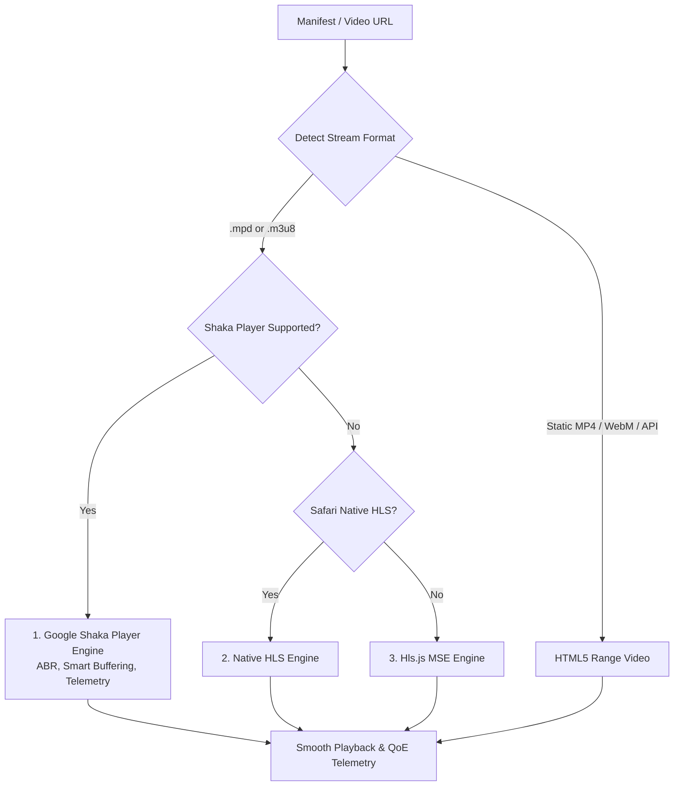
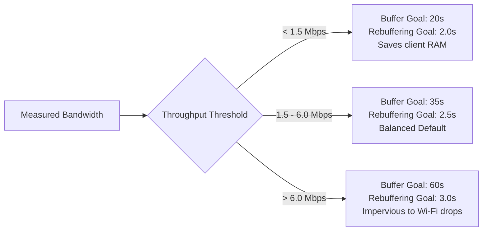
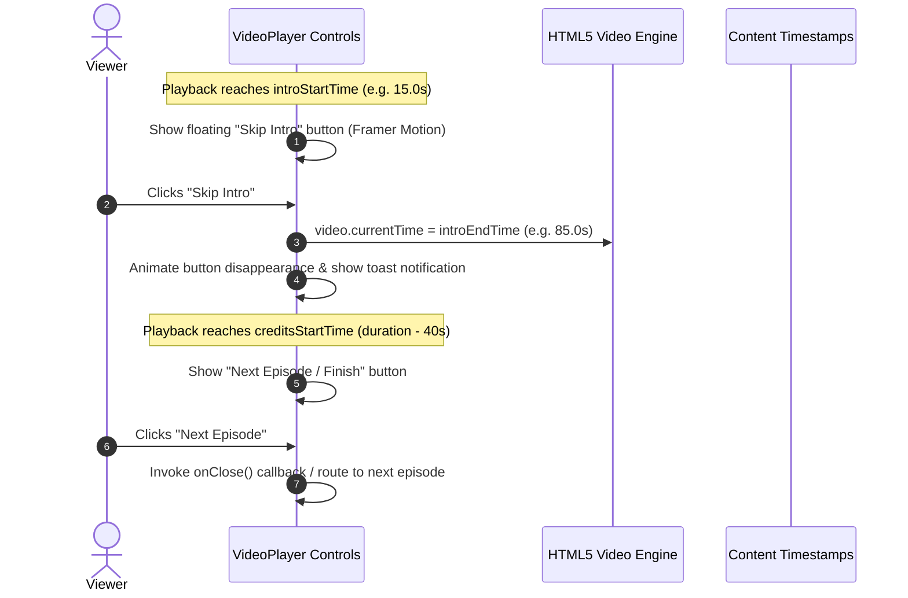
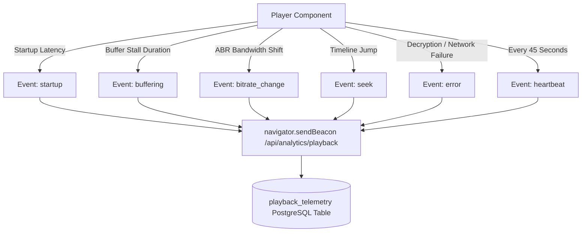

# 📺 StreamVault Playback & Video Player Engine

| Metadata | Details |
| :--- | :--- |
| **Title** | Video Player Architecture, Adaptive Bitrate & QoE Telemetry Specification |
| **Document ID** | STRM-002 |
| **Version** | 2.0.0 (Production Multi-Codec Enterprise Edition) |
| **Author** | Senior Video Streaming Systems Engineer & Lead Frontend Architect |
| **Date** | 2026-09-29 |
| **Purpose** | In-depth technical specification of the client-side playback engine, adaptive bitrate algorithms, dynamic network-dependent buffering, interactive content markers, and Quality of Experience (QoE) telemetry. |
| **Scope** | `src/components/player/video-player.tsx`, `src/components/player/player-modal.tsx`, and `/api/analytics/playback`. |

---

## 📑 Table of Contents

- [1. Playback Architecture Overview](#1-playback-architecture-overview)
- [2. Multi-Engine Cascading Playback Strategy](#2-multi-engine-cascading-playback-strategy)
  - [2.1 Tier 1: Google Shaka Player (MPEG-DASH & HLS)](#21-tier-1-google-shaka-player-mpeg-dash--hls)
  - [2.2 Tier 2: Apple Safari Native HLS Fallback](#22-tier-2-apple-safari-native-hls-fallback)
  - [2.3 Tier 3: Hls.js Media Source Extensions Fallback](#23-tier-3-hlsjs-media-source-extensions-fallback)
  - [2.4 Tier 4: Direct HTML5 Range Streaming & On-The-Fly Transcoding](#24-tier-4-direct-html5-range-streaming--on-the-fly-transcoding)
- [3. Adaptive Bitrate (ABR) & Bandwidth Adaptation](#3-adaptive-bitrate-abr--bandwidth-adaptation)
- [4. Smart Adaptive Network Buffering (20s–60s)](#4-smart-adaptive-network-buffering-20s60s)
- [5. Non-Rebuffering Quality Switching Protocol](#5-non-rebuffering-quality-switching-protocol)
- [6. Dynamic Content Markers: Skip Intro & Credits](#6-dynamic-content-markers-skip-intro--credits)
- [7. Multi-Audio & Subtitle Track Discovery](#7-multi-audio--subtitle-track-discovery)
- [8. Real-Time QoE Telemetry & Analytics Pipeline](#8-real-time-qoe-telemetry--analytics-pipeline)
- [9. Error Recovery, Backoff & Resilience Strategy](#9-error-recovery-backoff--resilience-strategy)
- [10. Implementation Gap Analysis & Recommendations](#10-implementation-gap-analysis--recommendations)
- [11. Cross References](#11-cross-references)

---

## 1. Playback Architecture Overview

The playback engine in StreamVault (`src/components/player/video-player.tsx`) is designed for instant startup, zero-rebuffering playback, and complete format resilience. It abstracts underlying browser variations through a tiered cascade:



---

## 2. Multi-Engine Cascading Playback Strategy

### 2.1 Tier 1: Google Shaka Player (MPEG-DASH & HLS)
- **Library**: `shaka-player` v5.2+ (`import("shaka-player")`).
- **Initialization**: Automatically polyfills MSE and EME via `shaka.polyfill.installAll()`.
- **Primary Transport**: MPEG-DASH (`manifest.mpd`) and Apple HLS (`master.m3u8`).
- **Advantages**: Full client-side ABR control, non-destructive variant track switching, dynamic adaptation listeners, and fine-grained buffer management.

### 2.2 Tier 2: Apple Safari Native HLS Fallback
- Activated when running on Apple WebKit browsers where native HLS handling is preferred or MSE is restricted (`video.canPlayType("application/vnd.apple.mpegurl")`).
- Direct assignation: `video.src = currentSrc`.

### 2.3 Tier 3: Hls.js Media Source Extensions Fallback
- Activated if Shaka initialization fails on an HLS source:
  ```typescript
  const hls = new Hls({ enableWorker: true, lowLatencyMode: true });
  hls.loadSource(currentSrc);
  hls.attachMedia(video);
  ```

### 2.4 Tier 4: Direct HTML5 Range Streaming & On-The-Fly Transcoding
- Used for single-file MP4/WebM containers or direct API streams (`/api/stream/media` or `/api/b2/`).
- Emits HTTP 206 Partial Content byte ranges in 4MB chunk increments.
- Spawns on-the-fly FFmpeg transcoding if non-native containers (such as MKV) or real-time downscaled resolutions (720p, 480p, 360p) are requested.

---

## 3. Adaptive Bitrate (ABR) & Bandwidth Adaptation

Shaka Player's ABR engine is tuned specifically to minimize stalls while avoiding aggressive quality oscillations:

```typescript
player.configure({
  abr: {
    enabled: true,
    defaultBandwidthEstimate: 3500000, // 3.5 Mbps startup default
    switchInterval: 3,                // Evaluates throughput every 3 seconds
    bandwidthUpgradeTarget: 0.85,     // Upgrade only if measured bandwidth > 117% required
    bandwidthDowngradeTarget: 0.95,   // Downgrade immediately if buffer health drops < 95%
  },
  streaming: {
    bufferingGoal: 35,
    rebufferingGoal: 2.5,
    bufferBehind: 30,
    retryParameters: {
      maxAttempts: 4,
      baseDelay: 1000,
      backoffFactor: 2,
    },
  },
});
```

---

## 4. Smart Adaptive Network Buffering (20s–60s)

A static buffer goal causes performance degradation: low-bandwidth connections suffer memory thrashing, while high-bandwidth connections suffer unnecessary rebuffering during transient Wi-Fi drops. StreamVault dynamically recalculates buffer depth based on real-time throughput:



Implementation in `src/components/player/video-player.tsx`:
```typescript
player.addEventListener("adaptation", () => {
  const stats = player.getStats();
  const bw = stats.estimatedBandwidth || 0;

  if (bw < 1500000) {
    player.configure({ streaming: { bufferingGoal: 20, rebufferingGoal: 2 } });
  } else if (bw > 6000000) {
    player.configure({ streaming: { bufferingGoal: 60, rebufferingGoal: 3 } });
  }

  sendTelemetry("bitrate_change", {
    currentBitrateBps: Math.round(bw),
    droppedFrames: stats.droppedFrames || 0,
  });
});
```

---

## 5. Non-Rebuffering Quality Switching Protocol

Unlike naive HTML5 implementations that reload the `video.src` (causing a black flash, timestamp reset, and buffer flush), StreamVault switches quality variants in Shaka Player directly at the demuxer layer:

```typescript
const matchingTrack = shakaTracksRef.current.find((t: any) => t.height === targetHeight);
if (matchingTrack) {
  // Disable automatic ABR to lock user selection
  player.configure({ abr: { enabled: false } });
  
  // clearBuffer = false guarantees zero playback interruption or timestamp jump
  player.selectVariantTrack(matchingTrack, false);
}
```

---

## 6. Dynamic Content Markers: Skip Intro & Credits

StreamVault synchronizes database markers (`introStartTime`, `introEndTime`, `creditsStartTime`) with the HTML5 video playback clock:



---

## 7. Multi-Audio & Subtitle Track Discovery

Tracks are parsed dynamically from the manifest rather than hardcoded in the frontend:
- **Audio Tracks**: Extracted via `player.getAudioLanguages()`. Switching languages invokes `player.selectAudioLanguage(lang)` without dropping video buffer frames.
- **Subtitles**: Extracted via `player.getTextTracks()`. Toggling subtitles calls `player.setTextTrackVisibility(true)` and selects the target WebVTT stream.

---

## 8. Real-Time QoE Telemetry & Analytics Pipeline

StreamVault captures client Quality of Experience metrics and dispatches them to `/api/analytics/playback` using `navigator.sendBeacon` (ensuring delivery even if the user closes the browser tab):



### Telemetry Payload Structure:
```json
{
  "sessionId": "session_1727500000_abc123",
  "contentId": 42,
  "profileId": 1,
  "eventType": "startup",
  "currentTime": 0,
  "startupLatencyMs": 380,
  "currentBitrateBps": 3200000,
  "currentResolution": "1080p",
  "droppedFrames": 0,
  "playerEngine": "shaka"
}
```

---

## 9. Error Recovery, Backoff & Resilience Strategy

1. **Network Retries**: Configured with exponential backoff (`baseDelay: 1000ms`, `backoffFactor: 2`, `maxAttempts: 4`).
2. **Error Recovery Modal**: If all retries fail, renders a retry button that cleans up the active player instance and falls back from DASH to direct HTTP Range streaming.
3. **Picture-in-Picture (PiP)**: Standard integration via HTML5 `video.requestPictureInPicture()`.

---

## 10. Implementation Gap Analysis & Recommendations

| Playback Feature | Current Implementation State | Production Recommendation |
| :--- | :--- | :--- |
| **Offline Downloads** | Missing (Requires external infrastructure) | Implement encrypted IndexedDB chunk storage with Cache API and Service Workers |
| **Google Cast / AirPlay** | Missing in UI controls | Integrate Google Cast Web SDK and Apple AirPlay Web API triggers |
| **Smart Manifest Preloading** | Incomplete | Prefetch `.mpd` and init segments when users hover over catalog cards |
| **DRM Integration** | Missing (ClearKey / Widevine / FairPlay) | Integrate Widevine Modular and FairPlay Streaming EME key sessions |

---

## 11. Cross References

- [Master Documentation Hub](file:///d:/clg/Projects/Netflix/docs/README.md)
- [Video Transcoding Pipeline](file:///d:/clg/Projects/Netflix/docs/video_streaming_pipeline.md)
- [System Architecture](file:///d:/clg/Projects/Netflix/docs/system_architecture.md)
- [REST API Reference](file:///d:/clg/Projects/Netflix/docs/api_reference.md)
- [Client Features & Specifications](file:///d:/clg/Projects/Netflix/docs/client_features_and_specifications.md)
