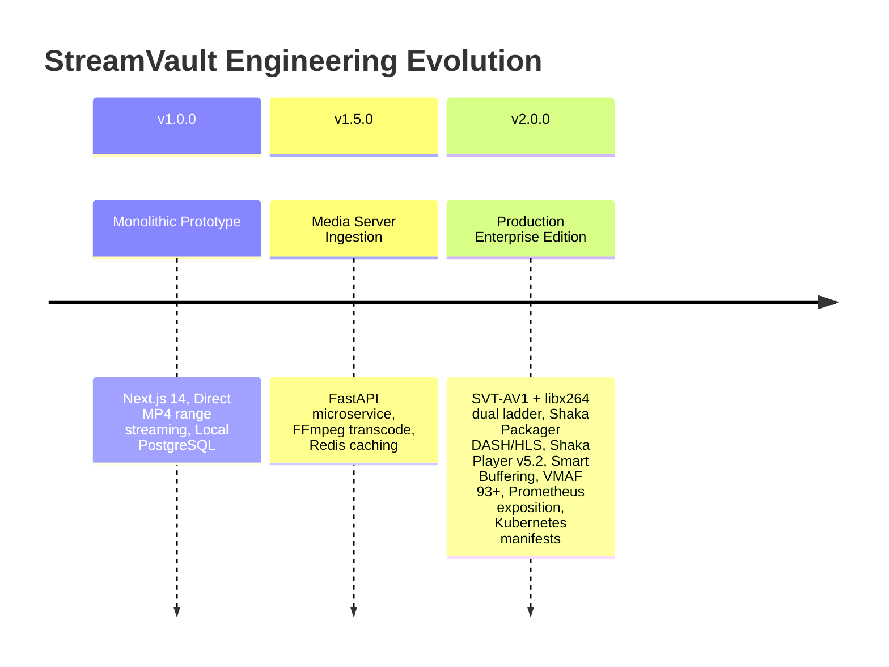
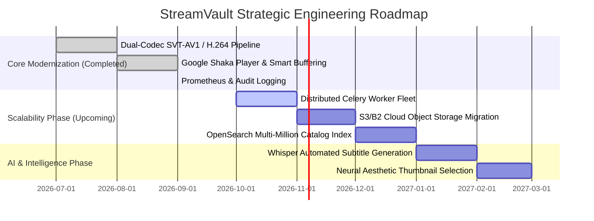

# 📊 StreamVault Project Management, Roadmap & Architecture Decision Records (ADRs)

| Metadata | Details |
| :--- | :--- |
| **Title** | Strategic Roadmap, Architecture Decision Records (ADRs), Risk Register & Sprint Planning |
| **Document ID** | PM-001 |
| **Version** | 2.0.0 (Production Multi-Codec Enterprise Edition) |
| **Author** | Principal Software Architect & Technical Program Manager |
| **Date** | 2026-09-29 |
| **Purpose** | Comprehensive project management record documenting platform vision, milestone achievements, Architecture Decision Records (ADRs), risk registers, technical debt tracking, and future roadmap phases. |
| **Scope** | Enterprise engineering lifecycle, architectural governance, and future releases. |

---

## 📑 Table of Contents

- [1. Platform Vision, Mission & Goals](#1-platform-vision-mission--goals)
- [2. Milestone History & Platform Evolution](#2-milestone-history--platform-evolution)
- [3. Architecture Decision Records (ADRs)](#3-architecture-decision-records-adrs)
  - [3.1 ADR-001: Adoption of SVT-AV1 with libx264 Universal Fallback](#31-adr-001-adoption-of-svt-av1-with-libx264-universal-fallback)
  - [3.2 ADR-002: Google Shaka Packager for Dual DASH & HLS Generation](#32-adr-002-google-shaka-packager-for-dual-dash--hls-generation)
  - [3.3 ADR-003: Google Shaka Player as Primary Client Streaming Engine](#33-adr-003-google-shaka-player-as-primary-client-streaming-engine)
  - [3.4 ADR-004: Redis Cache-Aside & Distributed Sliding-Window Rate Limiting](#34-adr-004-redis-cache-aside--distributed-sliding-window-rate-limiting)
  - [3.5 ADR-005: Synchronized Dual ORM (Drizzle ORM & SQLAlchemy 2.0)](#35-adr-005-synchronized-dual-orm-drizzle-orm--sqlalchemy-20)
- [4. Enterprise Risk Register](#4-enterprise-risk-register)
- [5. Technical Debt Inventory & Remediation Plan](#5-technical-debt-inventory--remediation-plan)
- [6. Sprint Planning & Strategic Roadmap](#6-sprint-planning--strategic-roadmap)
- [7. Cross References](#7-cross-references)

---

## 1. Platform Vision, Mission & Goals

- **Vision**: To deliver broadcast-quality video streaming globally with minimal bandwidth consumption, instantaneous startup times, and cinema-grade user immersion.
- **Mission**: Build an open, modular, cloud-native streaming platform engineered around modern open standards (AV1, DASH, HLS, WebVTT, Prometheus).
- **Core Goals**:
  1. Achieve sub-400ms startup latency globally across all modern client browsers.
  2. Reduce video bandwidth costs by 35% compared to legacy H.264 platforms using next-generation SVT-AV1 encoding.
  3. Ensure 99.99% uptime through horizontal pod autoscaling and stateless JWT authentication.

---

## 2. Milestone History & Platform Evolution

---

## 3. Architecture Decision Records (ADRs)

### 3.1 ADR-001: Adoption of SVT-AV1 with libx264 Universal Fallback
- **Context**: Video streaming consumes over 80% of platform bandwidth. High-efficiency codecs are mandatory to reduce egress costs.
- **Decision**: Produce dual video ladders: primary high-efficiency **SVT-AV1** (1080p @ 3.2M, 720p @ 1.8M, 480p @ 850k, 360p @ 450k) paired with universal **libx264 High Profile** fallback (1080p @ 4.5M, 720p @ 2.5M, 480p @ 1.2M).
- **Consequences**: Modern browsers enjoy significant data savings; legacy browsers and Safari continue to play smoothly without decode errors.

### 3.2 ADR-002: Google Shaka Packager for Dual DASH & HLS Generation
- **Context**: Generating separate DASH and HLS streams via raw FFmpeg is inefficient and prone to segment boundary drift.
- **Decision**: Transcode video and audio to elementary streams via FFmpeg, then execute **Google Shaka Packager** to fragment into 4-second `.m4s` segments and output both `manifest.mpd` and `master.m3u8`.
- **Consequences**: Guarantees bit-identical segment alignment between DASH and HLS with minimal disk footprint.

### 3.3 ADR-003: Google Shaka Player as Primary Client Streaming Engine
- **Context**: Standard HTML5 video elements cannot adaptively switch bitrates or handle segmented MPEG-DASH.
- **Decision**: Integrate **Google Shaka Player (`shaka-player` v5.2+)** as the primary client engine, with automated fallback to Hls.js and native video.
- **Consequences**: Enables non-rebuffering quality switching (`player.selectVariantTrack(t, false)`), dynamic network-dependent buffering (20s–60s), and comprehensive QoE telemetry capture.

### 3.4 ADR-004: Redis Cache-Aside & Distributed Sliding-Window Rate Limiting
- **Context**: Frequent database queries for billboard content, catalog listings, and search degrade PostgreSQL performance under spike traffic.
- **Decision**: Implement Redis cache-aside (`src/lib/cache.ts`) with TTLs (120s–300s) and a distributed sliding-window rate limiter using Redis sorted sets.
- **Consequences**: Database latency drops from ~150–250ms to $<5\text{ms}$ on cache hits; rate limiting is synchronized across all active Kubernetes pods.

### 3.5 ADR-005: Synchronized Dual ORM (Drizzle ORM & SQLAlchemy 2.0)
- **Context**: The platform consists of a Node.js front-end and a Python media server, both requiring access to PostgreSQL.
- **Decision**: Use **Drizzle ORM** in Node.js for zero-overhead TypeScript type safety and **SQLAlchemy 2.0** in Python for robust transcode job updates. `src/db/schema.ts` is maintained as the authoritative schema standard.
- **Consequences**: Zero runtime overhead on client APIs, with robust database transaction management during long-running media encoding tasks.

---

## 4. Enterprise Risk Register

| Risk ID | Category | Description | Likelihood | Impact | Mitigation Strategy |
| :---: | :--- | :--- | :---: | :---: | :--- |
| **RSK-01** | Technical | High CPU load during SVT-AV1 transcoding spikes. | High | High | Decouple media server onto dedicated Kubernetes worker nodes with resource limits; utilize AV1 Preset 6 for optimal compute efficiency. |
| **RSK-02** | Security | Token theft or session replay via XSS. | Low | Critical | Store JWTs exclusively in HttpOnly, SameSite=Lax cookies; rotate refresh tokens with SHA-256 hashing. |
| **RSK-03** | Operational | Storage volume exhaustion from raw video uploads. | Medium | High | Enforce pre-transcode SHA-256 deduplication and auto-purge raw source files upon successful job packaging. |
| **RSK-04** | Streaming | Rebuffering stalls on volatile mobile networks. | Medium | Medium | Implemented dynamic Smart Buffering adapting buffer goals between 20s and 60s based on real-time throughput. |

---

## 5. Technical Debt Inventory & Remediation Plan

1. **In-Process Task Dispatch**: Currently uses FastAPI `BackgroundTasks`.
   - *Remediation*: Transition to standalone Celery or BullMQ worker fleet with dedicated Redis broker in Release 2.2.0.
2. **Local Stream Chunk Storage**: Stream assets reside on local persistent volume mounts.
   - *Remediation*: Implement S3 / Backblaze B2 direct upload integration with automated Cloudflare Worker proxying in Release 2.3.0.
3. **In-Memory Fuzzy Search**: Levenshtein distance computed in Node.js memory on active catalog.
   - *Remediation*: Deploy dedicated OpenSearch or Meilisearch cluster once catalog exceeds 10,000 titles.

---

## 6. Sprint Planning & Strategic Roadmap

---

## 7. Cross References

- [Master Documentation Hub](file:///d:/clg/Projects/Netflix/docs/README.md)
- [System Architecture](file:///d:/clg/Projects/Netflix/docs/system_architecture.md)
- [Video Ingestion & Transcoding Pipeline](file:///d:/clg/Projects/Netflix/docs/video_streaming_pipeline.md)
- [Security Architecture & Audit](file:///d:/clg/Projects/Netflix/docs/security_architecture_and_audit.md)
- [DevOps & Kubernetes Operations](file:///d:/clg/Projects/Netflix/docs/devops_and_ci_cd.md)
