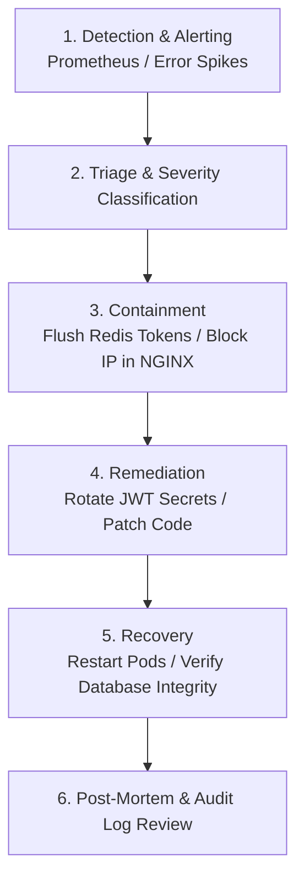

# 🛡️ StreamVault Security Architecture & Audit Specification

| Metadata | Details |
| :--- | :--- |
| **Title** | Security Architecture, Threat Model, Cryptographic Protocols & OWASP Top 10 Audit |
| **Document ID** | SEC-001 |
| **Version** | 2.0.0 (Production Multi-Codec Enterprise Edition) |
| **Author** | Principal Security Engineer & Cryptographic Systems Architect |
| **Date** | 2026-09-29 |
| **Purpose** | Authoritative security architecture detailing threat modeling, authentication, token rotation, signed URL verification, header hardening, directory traversal prevention, rate limiting, and incident response. |
| **Scope** | Complete codebase, network edge (NGINX), API routes (`src/app/api/`), cryptographic helpers (`src/lib/`), and database audit logs. |

---

## 📑 Table of Contents

- [1. Security Threat Model (STRIDE Methodology)](#1-security-threat-model-stride-methodology)
- [2. Authentication Architecture & Token Lifecycle](#2-authentication-architecture--token-lifecycle)
  - [2.1 Dual-Token Authentication Strategy](#21-dual-token-authentication-strategy)
  - [2.2 Refresh Token Rotation & Cryptographic Hashing](#22-refresh-token-rotation--cryptographic-hashing)
  - [2.3 Password Security & Hashing Standards](#23-password-security--hashing-standards)
- [3. Media Stream Protection & HMAC Signed URLs](#3-media-stream-protection--hmac-signed-urls)
  - [3.1 Token Construction & Signature Verification](#31-token-construction--signature-verification)
  - [3.2 Mitigation of Timing Attacks (Constant-Time Verification)](#32-mitigation-of-timing-attacks-constant-time-verification)
- [4. Defense-in-Depth & Perimeter Hardening](#4-defense-in-depth--perimeter-hardening)
  - [4.1 HTTP Secure Headers Policy](#41-http-secure-headers-policy)
  - [4.2 Directory Traversal & Injection Prevention](#42-directory-traversal--injection-prevention)
  - [4.3 Distributed Sliding-Window Rate Limiting](#43-distributed-sliding-window-rate-limiting)
- [5. Security Audit Logging & Compliance Trails](#5-security-audit-logging--compliance-trails)
- [6. OWASP Top 10 (2021) Verification Checklist](#6-owasp-top-10-2021-verification-checklist)
- [7. Incident Response Plan (IRP)](#7-incident-response-plan-irp)
- [8. Security Gap Analysis & Recommendations](#8-security-gap-analysis--recommendations)
- [9. Cross References](#9-cross-references)

---

## 1. Security Threat Model (STRIDE Methodology)

| STRIDE Category | Potential Threat | Architectural Mitigation in StreamVault |
| :--- | :--- | :--- |
| **Spoofing** | Adversary falsifies user or admin identity to access paid catalog. | Short-lived 15-minute JWTs stored in HttpOnly cookies; SHA-256 hashed refresh tokens. |
| **Tampering** | User modifies stream manifest URLs to bypass authorization. | Constant-time HMAC SHA-256 signed playback URLs with 3600s expiration. |
| **Repudiation** | Operator alters catalog or retries jobs without accountability. | Immutable `audit_logs` table recording user ID, action, IP, and timestamp. |
| **Information Disclosure**| Directory traversal to read sensitive host files (`/etc/passwd`). | Regex path sanitization rejecting path traversal sequences in `/api/stream/` and `/api/b2/`. |
| **Denial of Service** | Credential stuffing or API resource exhaustion. | Distributed sliding-window Redis rate limiter throttling requests by client IP. |
| **Elevation of Privilege**| Standard viewer performs admin video upload or user mutation. | Role-based authorization (`user_role = 'admin'`) enforced on administrative endpoints. |

---

## 2. Authentication Architecture & Token Lifecycle

### 2.1 Dual-Token Authentication Strategy
Implemented in `src/lib/auth.ts`:
- **Access Token**:
  - Encoded as a signed JSON Web Token (JWT) using the `jose` library.
  - Expiration: **15 minutes** (`ACCESS_TOKEN_EXPIRY = "15m"`).
  - Storage: Transported exclusively inside an `HttpOnly`, `SameSite=Lax`, and `Secure` cookie. JavaScript running in the browser cannot access this token, mitigating Cross-Site Scripting (XSS) token theft.
- **Refresh Token**:
  - High-entropy cryptographically random 64-byte hexadecimal string (`crypto.randomBytes(64).toString("hex")`).
  - Expiration: **30 days**.
  - Storage: Stored inside an `HttpOnly`, `SameSite=Strict` cookie.

### 2.2 Refresh Token Rotation & Cryptographic Hashing
To prevent token hijacking and replay attacks:
1. **Never Stored in Plain Text**: The database stores only the SHA-256 cryptographic hash of the refresh token (`token_hash = sha256(rawToken)`). If the database is compromised, active refresh tokens cannot be forged.
2. **Explicit Revocation**: Logging out sets `revoked_at = NOW()` on the token record, instantly terminating all subsequent sessions.

### 2.3 Password Security & Hashing Standards
- Hashed using **`bcryptjs`** with a work factor of **12 salt rounds**.
- Constant-time verification is employed to prevent user enumeration via timing discrepancies.

---

## 3. Media Stream Protection & HMAC Signed URLs

### 3.1 Token Construction & Signature Verification
Implemented in `src/lib/signed-url.ts`:
- Media assets are protected using cryptographic signatures valid for 3600 seconds (1 hour).
- **Signature Formula**:
  $$\text{Signature} = \text{HMAC-SHA256}(\text{CDN\_SECRET}, \text{key} \mathbin{\Vert} \text{":"} \mathbin{\Vert} \text{expires})$$

```typescript
export function generateSignedUrl(key: string, expiresInSec: number = 3600): string {
  const expires = Math.floor(Date.now() / 1000) + expiresInSec;
  const signature = crypto
    .createHmac("sha256", CDN_SECRET)
    .update(`${key}:${expires}`)
    .digest("hex");
  return `/api/stream/${encodeURIComponent(key)}?token=${signature}&expires=${expires}`;
}
```

### 3.2 Mitigation of Timing Attacks (Constant-Time Verification)
To prevent side-channel timing analysis that could allow an attacker to reconstruct a valid signature byte-by-byte:
```typescript
const sigBuffer = Buffer.from(token, "hex");
const expectedBuffer = Buffer.from(expectedSig, "hex");

if (sigBuffer.length !== expectedBuffer.length || !crypto.timingSafeEqual(sigBuffer, expectedBuffer)) {
  return false;
}
```

---

## 4. Defense-in-Depth & Perimeter Hardening

### 4.1 HTTP Secure Headers Policy
Configured in `nginx/nginx.conf`:
- `X-Content-Type-Options: nosniff`: Prevents MIME-type sniffing.
- `X-Frame-Options: SAMEORIGIN`: Prevents clickjacking attacks.
- `X-XSS-Protection: 1; mode=block`: Activates browser XSS filtering.
- `Strict-Transport-Security: max-age=31536000; includeSubDomains`: Enforces HTTPS transport.

### 4.2 Directory Traversal & Injection Prevention
All media serving endpoints sanitize input paths to prevent attackers from escaping public directories:
```typescript
// Sanitization in src/app/api/stream/media/route.ts
const cleanPath = fileParam.replace(/^\/+/, "");
const absolutePath = path.join(process.cwd(), "public", cleanPath);

// Traversal check
if (!absolutePath.startsWith(path.join(process.cwd(), "public"))) {
  return new NextResponse("Access denied", { status: 403 });
}
```

### 4.3 Distributed Sliding-Window Rate Limiting
- Auth endpoints: 15 requests per 15 minutes (mitigates brute-force credential stuffing).
- Telemetry ingestion: 180 requests per minute.
- Search queries: 45 requests per minute.

---

## 5. Security Audit Logging & Compliance Trails

Every administrative and security-critical action generates an immutable audit record in PostgreSQL (`src/lib/audit.ts`):

```mermaid
graph LR
    Action[Administrative Action] --> AuditSvc[logAudit() Service]
    AuditSvc --> DB[(audit_logs Table)]
    
    DB --> Fields["user_id<br/>action<br/>target_type<br/>target_id<br/>ip_address<br/>metadata<br/>created_at"]
```

---

## 6. OWASP Top 10 (2021) Verification Checklist

| OWASP Vulnerability | Status | Mitigation Technique in StreamVault |
| :--- | :---: | :--- |
| **A01: Broken Access Control** | **PASS** | Role-based check on Admin routes; profile ownership verified via `userId` foreign key. |
| **A02: Cryptographic Failures** | **PASS** | bcrypt (12 rounds) for passwords; SHA-256 for refresh tokens; HMAC SHA-256 for signed URLs. |
| **A03: Injection (SQL / Command)** | **PASS** | Parameterized queries via Drizzle ORM and SQLAlchemy; no shell interpolation in FFmpeg spawn. |
| **A04: Insecure Design** | **PASS** | Sliding-window rate limiting; multi-tier ABR buffering; stateless JWT rotation. |
| **A05: Security Misconfiguration** | **PASS** | Default passwords prohibited in prod manifests; strict CORS rules on stream chunks. |
| **A06: Vulnerable Components** | **PASS** | Dependencies pinned; unit tests enforce integrity probes before transcode. |
| **A07: Identification & Auth** | **PASS** | Short-lived 15m access tokens; database-revocable refresh tokens; strict rate limits. |
| **A08: Software & Data Integrity** | **PASS** | Pre-transcode SHA-256 file hashing; container duration verification. |
| **A09: Security Logging & Monitoring**| **PASS** | Dedicated `audit_logs` table; Prometheus metrics exposition at `/api/metrics`. |
| **A10: Server-Side Request Forgery** | **PASS** | B2 proxy validates hostname and scheme against whitelist; no arbitrary external fetching. |

---

## 7. Incident Response Plan (IRP)



1. **Step 1: Emergency Token Invalidation**:
   If secrets are suspected to be compromised, update `revoked_at = NOW()` across the entire `refresh_tokens` table to force all global users to re-authenticate.
2. **Step 2: IP-Level Perimeter Blocking**:
   Add malicious subnet to `nginx/nginx.conf` (`deny 198.51.100.0/24;`) and reload NGINX (`nginx -s reload`).

---

## 8. Security Gap Analysis & Recommendations

| Security Dimension | Codebase Reality | Production Recommendation |
| :--- | :--- | :--- |
| **Secret Management** | Environment variables (`.env`, `configmap.yaml`) | Integrate HashiCorp Vault or AWS Secrets Manager with automatic rotation |
| **DRM Integration** | HMAC signed URLs and ClearKey | Integrate Widevine Modular and Apple FairPlay DRM key exchange |
| **Vulnerability Scanning** | Manual `npm audit` | Automated Trivy / Snyk image scanning in CI/CD pipeline |
| **WAF Integration** | NGINX rate limiting | Enterprise Cloudflare WAF / AWS WAF with bot protection rules |

---

## 9. Cross References

- [Master Documentation Hub](file:///d:/clg/Projects/Netflix/docs/README.md)
- [System Architecture](file:///d:/clg/Projects/Netflix/docs/system_architecture.md)
- [REST API Reference](file:///d:/clg/Projects/Netflix/docs/api_reference.md)
- [Compliance & Legal Standards](file:///d:/clg/Projects/Netflix/docs/compliance_and_legal.md)
- [DevOps & Kubernetes Operations](file:///d:/clg/Projects/Netflix/docs/devops_and_ci_cd.md)
