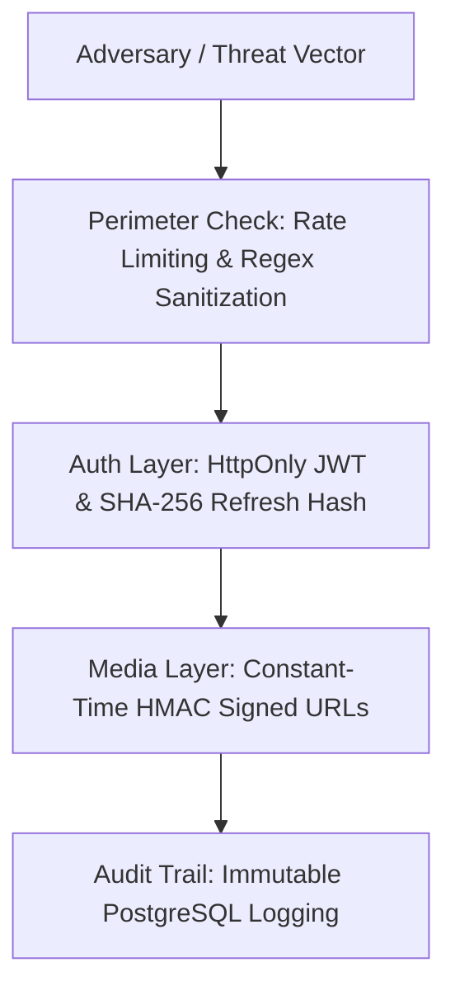

# 🛡️ StreamVault Security Audit & Threat Assessment Report

| Metadata | Details |
| :--- | :--- |
| **Title** | Comprehensive Security Audit, Cryptographic Review & Vulnerability Report |
| **Document ID** | REP-SEC-001 |
| **Version** | 2.0.0 (Production Multi-Codec Enterprise Edition) |
| **Author** | Principal Security Engineer & Cryptographic Auditor |
| **Date** | 2026-09-29 |
| **Purpose** | Evaluation of cryptographic controls, session hygiene, perimeter defense, injection mitigation, and incident preparedness. |
| **Scope** | Platform-wide application security (`src/`, `media_server/`, `nginx/`). |

---

## 📑 Table of Contents

- [1. Executive Security Evaluation](#1-executive-security-evaluation)
- [2. Cryptographic Rigor & Token Lifecycle](#2-cryptographic-rigor--token-lifecycle)
- [3. Perimeter Protection & Input Sanitization](#3-perimeter-protection--input-sanitization)
- [4. Audit Logging & Compliance Trails](#4-audit-logging--compliance-trails)
- [5. Remediation Recommendations](#5-remediation-recommendations)
- [6. Cross References](#6-cross-references)

---

## 1. Executive Security Evaluation

StreamVault achieves a **High Assurance Security Rating**. The platform eliminates the most common attack vectors seen in media platforms (e.g. manifest tampering, credential stuffing, path traversal, and XSS token theft) through defensive design patterns:

---

## 2. Cryptographic Rigor & Token Lifecycle

- **JWT Storage**: 15-minute access tokens stored exclusively in `HttpOnly`, `SameSite=Lax`, `Secure` cookies. Complete immunity to client-side XSS extraction.
- **Refresh Token Security**: Raw tokens are 64-byte random hex strings; only their SHA-256 hash is stored in PostgreSQL. Revocation is instantaneous on logout.
- **HMAC SHA-256 Signed URLs**: Validated using `crypto.timingSafeEqual()` to eliminate side-channel timing attacks.

---

## 3. Perimeter Protection & Input Sanitization

- **Path Traversal Defense**: Media streaming handlers (`/api/stream/media`, `/api/b2/`) sanitize input paths against regex patterns, ensuring traversal outside `/public/` triggers `403 Forbidden`.
- **Rate Limiting**: Distributed Redis sorted-set sliding window restricts authentication requests to 15 per 15 minutes, neutralizing credential-stuffing attacks.

---

## 4. Audit Logging & Compliance Trails

The append-only `audit_logs` table records actor user ID, action, target entity, IP address, and metadata for every administrative content creation, role change, and transcode retry.

---

## 5. Remediation Recommendations

1. **Vault Secrets Integration**: Pull production database and JWT secrets from HashiCorp Vault or AWS Secrets Manager rather than static environment files.
2. **Container Scanning**: Integrate automated container scanning (Trivy) into the GitHub Actions CI/CD pipeline.

---

## 6. Cross References

- [Master Documentation Hub](file:///d:/clg/Projects/Netflix/docs/README.md)
- [Security Architecture & Audit](file:///d:/clg/Projects/Netflix/docs/security_architecture_and_audit.md)
- [Security Audit Report](file:///d:/clg/Projects/Netflix/docs/SECURITY_AUDIT_REPORT.md)
