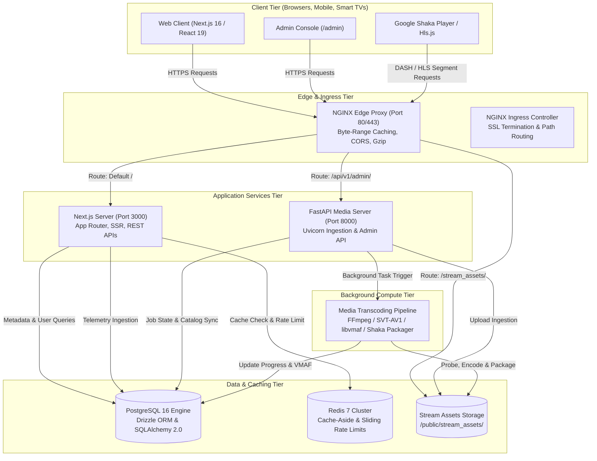
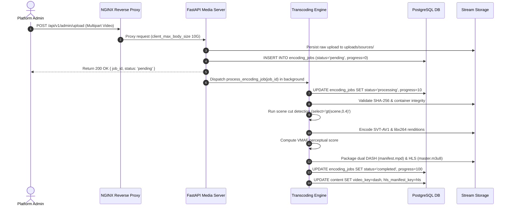
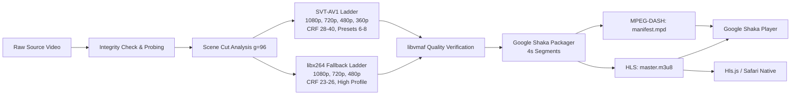
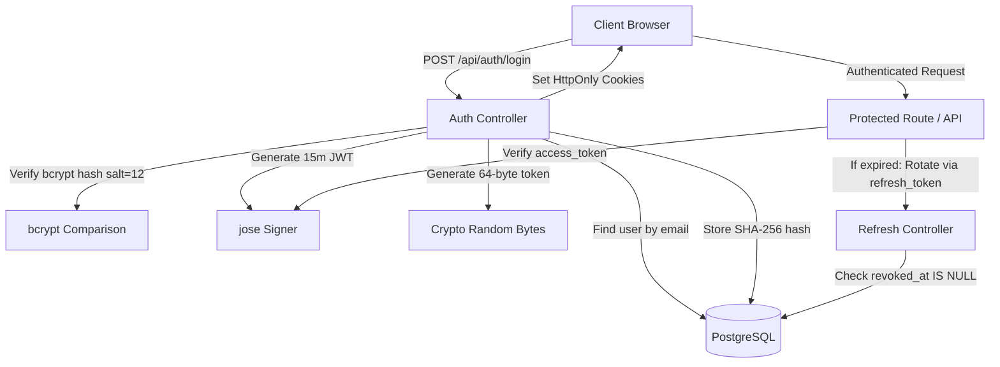

# 🏛️ StreamVault System Architecture Specification

| Metadata | Details |
| :--- | :--- |
| **Title** | StreamVault Enterprise System Architecture |
| **Document ID** | ARCH-001 |
| **Version** | 2.0.0 (Production Multi-Codec Enterprise Edition) |
| **Author** | Principal Software Architect & Principal Distributed Systems Engineer |
| **Date** | 2026-09-29 |
| **Purpose** | Comprehensive architectural blueprint detailing components, topology, data flows, scalability, high availability, and network topologies. |
| **Scope** | Complete StreamVault platform encompassing NGINX reverse proxy, Next.js web application, FastAPI media server, PostgreSQL persistence, Redis cache/queue, and Kubernetes container orchestration. |

---

## 📑 Table of Contents

- [1. Executive System Topology](#1-executive-system-topology)
- [2. Component & Tier Architecture](#2-component--tier-architecture)
  - [2.1 Edge Delivery & Reverse Proxy Tier](#21-edge-delivery--reverse-proxy-tier)
  - [2.2 Application & User Experience Tier](#22-application--user-experience-tier)
  - [2.3 Media Transcoding & Ingestion Tier](#23-media-transcoding--ingestion-tier)
  - [2.4 Persistence, Caching & Queue Tier](#24-persistence-caching--queue-tier)
- [3. Backend Architecture](#3-backend-architecture)
- [4. Frontend Architecture](#4-frontend-architecture)
- [5. Video Streaming Architecture](#5-video-streaming-architecture)
- [6. Caching & Persistence Architecture](#6-caching--persistence-architecture)
  - [6.1 Cache-Aside Engine & Eviction Policies](#61-cache-aside-engine--eviction-policies)
  - [6.2 Distributed Sliding-Window Rate Limiting](#62-distributed-sliding-window-rate-limiting)
- [7. Search & Recommendation Architecture](#7-search--recommendation-architecture)
- [8. Security & Authentication Architecture](#8-security--authentication-architecture)
- [9. Network, CDN & Load Balancer Topology](#9-network-cdn--load-balancer-topology)
- [10. Scalability, High Availability & Disaster Recovery](#10-scalability-high-availability--disaster-recovery)
- [11. Architectural Gap Analysis & Recommendations](#11-architectural-gap-analysis--recommendations)
- [12. Cross References](#12-cross-references)

---

## 1. Executive System Topology

StreamVault is designed as a distributed, service-oriented streaming system optimized for high concurrency, low latency, and efficient media delivery. The platform separates compute-heavy media transcoding operations from user-facing metadata queries and dynamic rendering.



---

## 2. Component & Tier Architecture

### 2.1 Edge Delivery & Reverse Proxy Tier
- **Technology**: NGINX 1.25 Alpine / Kubernetes Ingress Controller.
- **Responsibilities**:
  - Acts as the single perimeter ingress for all external HTTP traffic.
  - Serves packaged DASH (`.mpd`), HLS (`.m3u8`), fragmented MP4 (`.m4s`), and WebVTT subtitle segments directly from the `/public/stream_assets/` mount.
  - Emits CORS headers (`Access-Control-Allow-Origin: *`, `Access-Control-Allow-Headers: Range, Content-Type`) to enable cross-origin video chunk requests.
  - Supports HTTP byte-range requests (`Accept-Ranges: bytes`) enabling instant random seeking without downloading entire video containers.
  - Compresses manifest XML and text playlists with gzip (`application/dash+xml`, `application/vnd.apple.mpegurl`, `text/vtt`).

### 2.2 Application & User Experience Tier
- **Technology**: Next.js 16 (App Router), React 19, TypeScript 5.9, Zustand 5.0, Framer Motion 13.
- **Responsibilities**:
  - Serves server-side rendered (SSR) catalog pages with instant First Contentful Paint (FCP).
  - Exposes RESTful API endpoints under `/api/` for authentication, content catalog, profiles, search, ratings, comments, and telemetry.
  - Integrates the Google Shaka Player component (`src/components/player/video-player.tsx`) with dynamic adaptive bitrate (ABR) streaming and smart buffering.

### 2.3 Media Transcoding & Ingestion Tier
- **Technology**: FastAPI 0.110, Uvicorn, Python 3.11, FFmpeg, Google Shaka Packager.
- **Responsibilities**:
  - Handles multipart uploads of large master video files (up to 10GB container limit).
  - Runs pre-transcode SHA-256 cryptographic hashing and container stream integrity checks.
  - Coordinates multi-rendition dual-codec encoding (SVT-AV1 and libx264) via background worker processes.
  - Calculates VMAF perceptual quality scores and generates multi-codec DASH and HLS manifests.

### 2.4 Persistence, Caching & Queue Tier
- **Technology**: PostgreSQL 16 Alpine, Redis 7 Alpine.
- **Responsibilities**:
  - **PostgreSQL**: Stores relational models (users, profiles, refresh tokens, content catalog, episodes, watch history, ratings, comments, playback telemetry, and audit logs).
  - **Redis**: Provides sub-5ms caching for hot catalog listings, featured billboards, and search results; coordinates distributed sliding-window rate limit counters across all running pods.

---

## 3. Backend Architecture

StreamVault employs a hybrid backend architecture consisting of:
1. **Next.js Node.js Runtime (`src/app/api/`)**:
   - Manages stateless user sessions using cookie-based JWT access tokens (15-minute expiration) and database-backed refresh tokens (30-day expiration).
   - Implements the Redis cache-aside helper `cachedQuery()` in `src/lib/cache.ts`.
   - Executes atomic sliding-window rate checks via `src/lib/rate-limit.ts`.
   - Serves Prometheus telemetry via `/api/metrics` using raw database pool counters.
2. **FastAPI Media Service (`media_server/`)**:
   - Executes asynchronous media processing tasks decoupled from user request threads.
   - Synchronizes database state directly with PostgreSQL using SQLAlchemy 2.0 declarative models (`media_server/app/models.py`).



---

## 4. Frontend Architecture

The user interface follows a modern reactive design pattern built with React 19 and Next.js 16 App Router:
- **State Management**:
  - **Zustand**: Client-side stores managing active user profile, mute state, and player modal visibility.
  - **React Hot Toast**: Unobtrusive user notification notifications for quality changes and errors.
- **Player Interface**:
  - Wrapped inside `PlayerModal` (`src/components/player/player-modal.tsx`) with zero layout shift.
  - Embedded Google Shaka Player (`src/components/player/video-player.tsx`) handling Media Source Extensions (MSE) playback, custom controls, Dynamic Marker detection ("Skip Intro" and "Next Episode"), and periodic QoE telemetry emissions.

---

## 5. Video Streaming Architecture

StreamVault utilizes a dual-codec, dual-manifest adaptive streaming architecture:



### Key Technical Characteristics:
1. **Segment Duration**: 4.0 seconds per fragment (`SEGMENT_DURATION_SEC = 4`).
2. **Keyframe Interval**: Exactly 96 frames (`KEYFRAME_INTERVAL = 96`), ensuring every segment boundary begins with an IDR keyframe at 24fps.
3. **Adaptive Bitrate Tuning**:
   - `switchInterval`: 3 seconds.
   - `bandwidthUpgradeTarget`: 0.85 (conservatively prevents premature quality switches).
   - `bandwidthDowngradeTarget`: 0.95 (rapidly drops resolution to prevent player stalls).

---

## 6. Caching & Persistence Architecture

### 6.1 Cache-Aside Engine & Eviction Policies
Implemented in `src/lib/cache.ts`:
- **Featured Billboard Content**: TTL = 300 seconds (`featured:content`).
- **Catalog Listings**: TTL = 180 seconds (`content:list:${type}:${genre}:${offset}`).
- **Content Details**: TTL = 300 seconds (`content:slug:${slug}`).
- **Ranked Search Results**: TTL = 120 seconds (`search:ranked:${cleanQuery}`).
- **Recommendations**: TTL = 600 seconds (`recommendations:profile:${id}`).

### 6.2 Distributed Sliding-Window Rate Limiting
Implemented in `src/lib/rate-limit.ts`:
- Backed by Redis Sorted Sets (`ZADD`, `ZREMRANGEBYSCORE`, `ZCARD`, `EXPIRE`).
- Window sliding granularity calculated in milliseconds.
- Tiers:
  - `auth`: 15 requests / 15 minutes.
  - `api`: 120 requests / minute.
  - `search`: 45 requests / minute.
  - `progress`: 30 requests / 10 seconds.
  - `telemetry`: 180 requests / minute.

---

## 7. Search & Recommendation Architecture

1. **Ranked Fuzzy Search (`/api/content/search`)**:
   - **Tier 1 (Exact & Prefix Match)**: Exact title matches assigned score 100; prefix matches assigned score 80.
   - **Tier 2 (Levenshtein Fuzzy Matching)**: For words of length $\ge 4$, computes edit distance. Matches with distance $\le 2$ are scored with a penalty ($20 - 5 \times \text{distance}$) to forgive user misspellings.
   - **Tier 3 (Metadata Overlap)**: Cast, director, genre, and synopsis tokens match with weights between 10 and 18.
2. **Hybrid Recommendation Engine (`/api/recommendations`)**:
   - Analyzes profile signals: completed content ($>50\%$ duration) assigned weight 1.5; ratings $\ge 4$ stars assigned weight 2.0; negative ratings ($\le 2$ stars) penalized with weight -1.0.
   - Aggregates genre and creator vectors and computes cosine similarity against published catalog items.
   - Includes cold-start algorithm serving top-rated titles sorted by `imdb_rating`.

---

## 8. Security & Authentication Architecture



---

## 9. Network, CDN & Load Balancer Topology

```mermaid
graph TB
    Internet((Public Internet)) --> Anycast[Cloudflare / Edge CDN]
    Anycast --> Ingress[NGINX Ingress Controller]
    
    subgraph K8sCluster["Kubernetes Cluster (Namespace: streamvault)"]
        Ingress --> ServiceWeb[Service: streamvault-client-admin<br/>Port 3000]
        Ingress --> ServiceMedia[Service: streamvault-media-server<br/>Port 8000]
        
        ServiceWeb --> PodWeb1[Pod: Client-Admin 1]
        ServiceWeb --> PodWeb2[Pod: Client-Admin 2]
        ServiceWeb --> PodWebN[Pod: Client-Admin N (HPA 2-10)]
        
        ServiceMedia --> PodMedia1[Pod: Media Server 1]
    end

    PodWeb1 --> RedisService[(Redis Service)]
    PodWeb1 --> DBService[(PostgreSQL Service)]
```

---

## 10. Scalability, High Availability & Disaster Recovery

### 10.1 Horizontal Pod Autoscaling (HPA)
The web client and API layer includes an HPA manifest (`k8s/client-admin.yaml`):
- Minimum replicas: 2
- Maximum replicas: 10
- Scale triggers: Target CPU utilization $\ge 75\%$, Target Memory utilization $\ge 80\%$.

### 10.2 Database Resiliency & Connection Pooling
- PostgreSQL connection pool initialized with Neon / pg pool (`src/db/index.ts`).
- Metric monitoring via `/api/metrics` tracks total, idle, and waiting connection counts to detect pool exhaustion before cascading failures occur.

---

## 11. Architectural Gap Analysis & Recommendations

| Architecture Dimension | Current Implementation | Production Recommendation |
| :--- | :--- | :--- |
| **Worker Queue** | FastAPI `BackgroundTasks` (in-process) | External Celery or BullMQ worker fleet with dedicated Redis broker |
| **Media Storage** | Local volume mount `/public/stream_assets/` | Distributed S3/B2 bucket with CloudFront / Cloudflare Worker CDN |
| **Database Scaling** | Single PostgreSQL instance | Primary-Replica topology with PgBouncer connection multiplexing |
| **Telemetry Ingestion** | Direct DB `INSERT` into `playback_telemetry` | Kafka / Redpanda stream buffer with ClickHouse time-series store |
| **Search Engine** | In-memory Levenshtein matching on active catalog | Dedicated OpenSearch / Meilisearch cluster for multi-million item catalogs |

---

## 12. Cross References

- [Master Documentation Index](file:///d:/clg/Projects/Netflix/docs/README.md)
- [Data Flows & Sequence Diagrams](file:///d:/clg/Projects/Netflix/docs/data_flows_and_sequences.md)
- [Video Transcoding Pipeline](file:///d:/clg/Projects/Netflix/docs/video_streaming_pipeline.md)
- [Database Design & Schema](file:///d:/clg/Projects/Netflix/docs/database_design_and_schema.md)
- [REST API Reference](file:///d:/clg/Projects/Netflix/docs/api_reference.md)
- [DevOps & Kubernetes Deployment](file:///d:/clg/Projects/Netflix/docs/devops_and_ci_cd.md)
