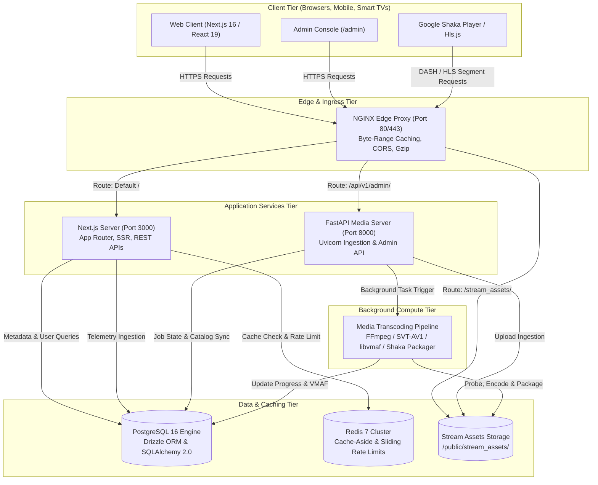
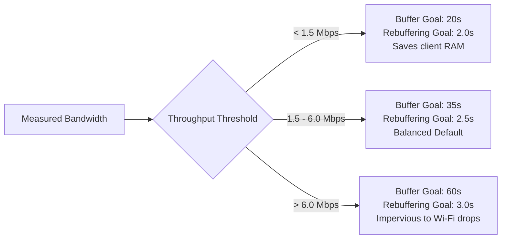
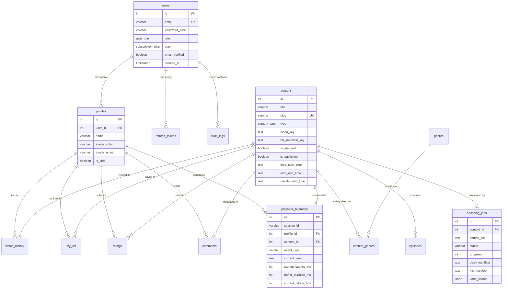
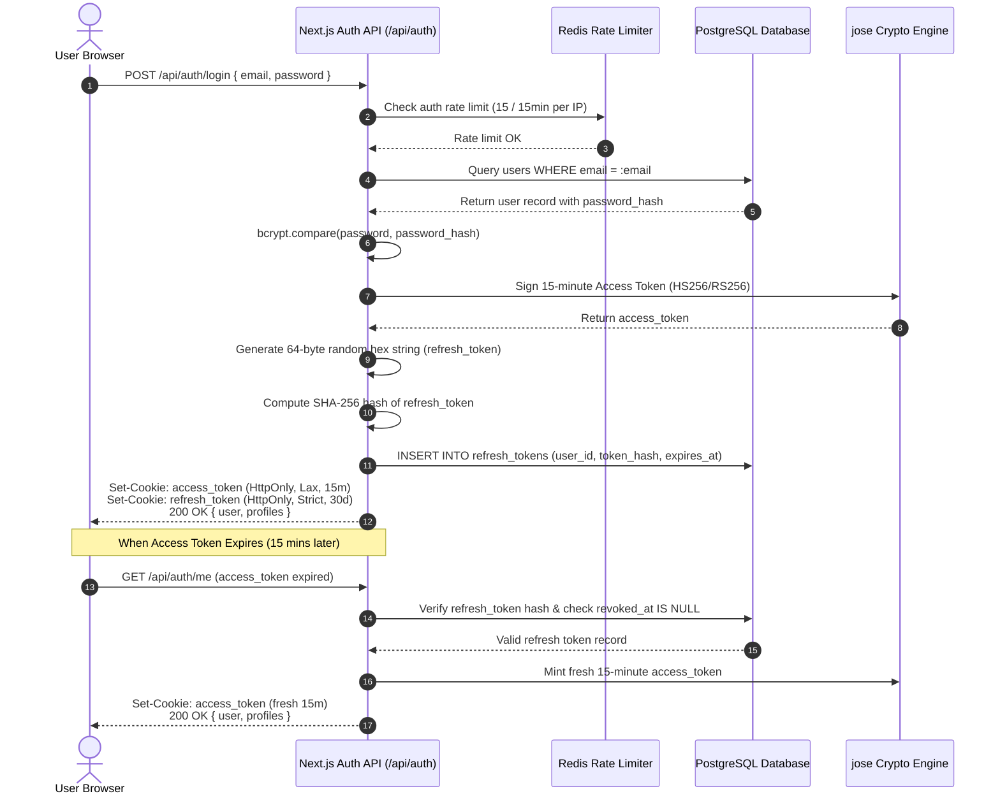
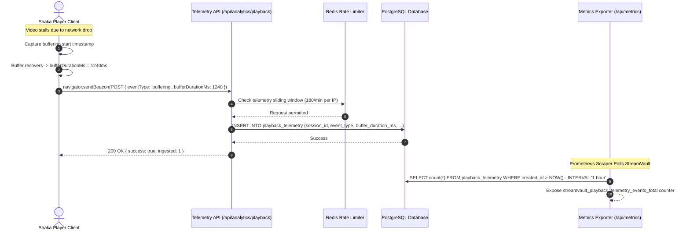
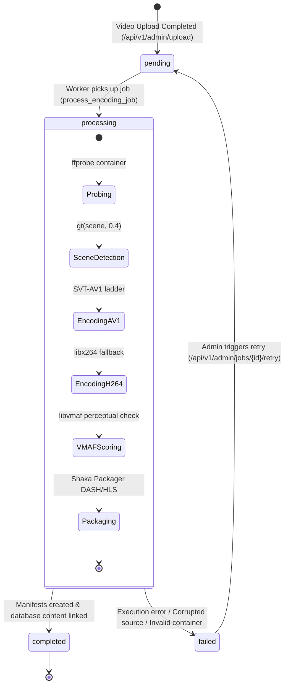
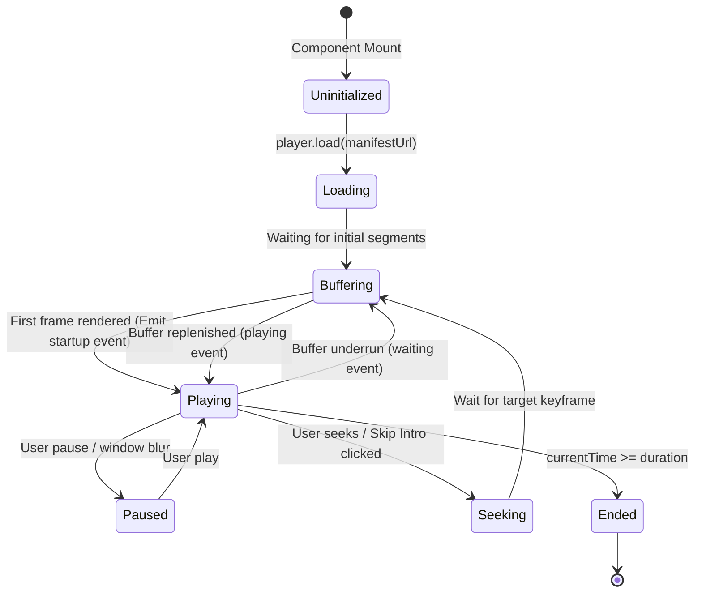

# 🗺️ StreamVault System Architecture Diagrams Catalog

| Metadata | Details |
| :--- | :--- |
| **Title** | Master Visual Architectural Models & Mermaid Diagram Reference |
| **Document ID** | DIAG-001 |
| **Version** | 2.0.0 (Production Multi-Codec Enterprise Edition) |
| **Author** | Principal Software Architect & Systems Modeler |
| **Date** | 2026-09-29 |
| **Purpose** | Centralized visual catalog containing all system topology diagrams, streaming pipelines, entity models, state machines, and sequence interactions in Mermaid format. |
| **Scope** | Complete StreamVault streaming platform. |

---

## 📑 Table of Contents

- [1. High-Level System Architecture Diagram](#1-high-level-system-architecture-diagram)
- [2. Media Ingestion & Dual-Codec Transcoding Pipeline](#2-media-ingestion--dual-codec-transcoding-pipeline)
- [3. Google Shaka Player Playback & Smart Buffering Flow](#3-google-shaka-player-playback--smart-buffering-flow)
- [4. Complete Entity-Relationship (ER) Model](#4-complete-entity-relationship-er-model)
- [5. Authentication & JWT Rotation Sequence](#5-authentication--jwt-rotation-sequence)
- [6. Real-Time QoE Telemetry Pipeline Sequence](#6-real-time-qoe-telemetry-pipeline-sequence)
- [7. Encoding Job Lifecycle State Machine](#7-encoding-job-lifecycle-state-machine)
- [8. Video Player Client State Machine](#8-video-player-client-state-machine)
- [9. Kubernetes Production Cluster Deployment Topology](#9-kubernetes-production-cluster-deployment-topology)
- [10. Cross References](#10-cross-references)

---

## 1. High-Level System Architecture Diagram



---

## 2. Media Ingestion & Dual-Codec Transcoding Pipeline

```mermaid
graph TD
    Upload[Raw Video Upload] --> Verify[1. SHA-256 Hash & ffprobe Integrity Check]
    Verify --> Scene[2. FFmpeg Scene Detection gt(scene, 0.4)]
    
    Scene --> DemuxA[3a. Extract Audio Tracks to AAC]
    Scene --> DemuxS[3b. Demux Subtitles to WebVTT]
    Scene --> EncodeAV1[3c. SVT-AV1 Multi-Bitrate Ladder]
    Scene --> EncodeH264[3d. libx264 Fallback Ladder]
    
    EncodeAV1 --> VMAF[4. VMAF Perceptual Quality Check libvmaf]
    EncodeH264 --> VMAF
    
    Scene --> Assets[5. Generate Thumbnails & 6s Preview Clip]
    
    VMAF --> Packager[6. Google Shaka Packager 4s Segments]
    DemuxA --> Packager
    DemuxS --> Packager
    
    Packager --> MPD[MPEG-DASH: manifest.mpd]
    Packager --> M3U8[HLS: master.m3u8]
    
    MPD --> Storage[Public Stream Assets: /public/stream_assets/{id}/]
    M3U8 --> Storage
    Assets --> Storage
```

---

## 3. Google Shaka Player Playback & Smart Buffering Flow



---

## 4. Complete Entity-Relationship (ER) Model



---

## 5. Authentication & JWT Rotation Sequence



---

## 6. Real-Time QoE Telemetry Pipeline Sequence



---

## 7. Encoding Job Lifecycle State Machine



---

## 8. Video Player Client State Machine



---

## 9. Kubernetes Production Cluster Deployment Topology

```mermaid
graph TB
    Internet((Public Internet)) --> Ingress[NGINX Ingress Controller<br/>Port 80/443 SSL]
    
    subgraph K8sCluster["Kubernetes Cluster (Namespace: streamvault)"]
        Ingress --> ServiceWeb[Service: streamvault-client-admin<br/>Port 3000]
        Ingress --> ServiceMedia[Service: streamvault-media-server<br/>Port 8000]
        
        ServiceWeb --> PodWeb1[Pod: Client-Admin 1]
        ServiceWeb --> PodWeb2[Pod: Client-Admin 2]
        ServiceWeb --> PodWebN[Pod: Client-Admin N (HPA 2-10)]
        
        ServiceMedia --> PodMedia1[Pod: Media Server 1]
    end

    PodWeb1 --> RedisService[(Redis Service)]
    PodWeb1 --> DBService[(PostgreSQL Service)]
```

---

## 10. Cross References

- [Master Documentation Hub](file:///d:/clg/Projects/Netflix/docs/README.md)
- [System Architecture](file:///d:/clg/Projects/Netflix/docs/system_architecture.md)
- [Data Flows & Sequence Diagrams](file:///d:/clg/Projects/Netflix/docs/data_flows_and_sequences.md)
- [Video Ingestion & Transcoding Pipeline](file:///d:/clg/Projects/Netflix/docs/video_streaming_pipeline.md)
- [Database Architecture & Schema](file:///d:/clg/Projects/Netflix/docs/database_design_and_schema.md)
