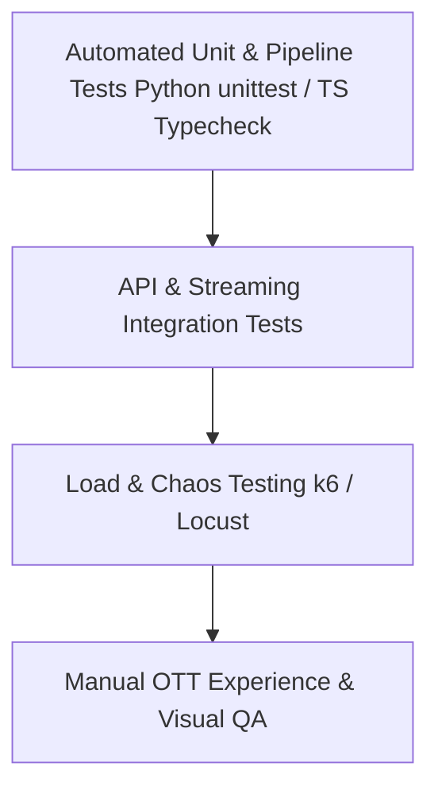
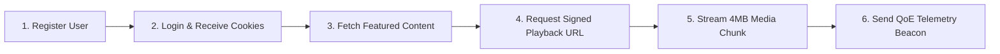

# 🧪 StreamVault Testing Strategy & Quality Assurance Guide

| Metadata | Details |
| :--- | :--- |
| **Title** | Comprehensive QA Strategy, Automated Test Suites, Load Testing & Verification Protocols |
| **Document ID** | QA-001 |
| **Version** | 2.0.0 (Production Multi-Codec Enterprise Edition) |
| **Author** | QA Lead & Streaming Verification Engineer |
| **Date** | 2026-09-29 |
| **Purpose** | Authoritative testing framework detailing automated unit test suites, TypeScript type compilation verification, API integration tests, streaming performance benchmarks, and bug reporting protocols. |
| **Scope** | `media_server/tests/`, `.github/workflows/ci.yml`, `package.json`, and API testing specifications. |

---

## 📑 Table of Contents

- [1. Quality Assurance Philosophy & Testing Pyramid](#1-quality-assurance-philosophy--testing-pyramid)
- [2. Automated Python Pipeline Unit Tests (`test_pipeline.py`)](#2-automated-python-pipeline-unit-tests-test_pipelinepy)
- [3. TypeScript Compilation & Static Code Analysis](#3-typescript-compilation--static-code-analysis)
- [4. API Integration & Route Verification](#4-api-integration--route-verification)
- [5. Video Streaming & Playback Verification Protocols](#5-video-streaming--playback-verification-protocols)
- [6. High-Concurrency Load & Stress Testing](#6-high-concurrency-load--stress-testing)
- [7. Security & Penetration Testing Procedures](#7-security--penetration-testing-procedures)
- [8. Standard Bug Reporting Protocol & Template](#8-standard-bug-reporting-protocol--template)
- [9. Testing Gap Analysis & Recommendations](#9-testing-gap-analysis--recommendations)
- [10. Cross References](#10-cross-references)

---

## 1. Quality Assurance Philosophy & Testing Pyramid

StreamVault adheres to an enterprise testing pyramid prioritizing automated verification before production deployments:



---

## 2. Automated Python Pipeline Unit Tests (`test_pipeline.py`)

Implemented in `media_server/tests/test_pipeline.py`:
- **Framework**: Python Standard `unittest`.
- **Execution Command**:
  ```bash
  python -m unittest media_server/tests/test_pipeline.py
  ```

### Test Suite Breakdown (5/5 Tests Passing):
1. **`test_supported_containers`**: Verifies that all 10 standard media formats (`.mp4`, `.mkv`, `.mov`, `.avi`, `.webm`, `.m4v`, `.flv`, `.ts`, `.mpeg`, `.wmv`) are permitted by the ingestion policy.
2. **`test_unsupported_container_raises`**: Validates that non-video extensions (e.g. `.txt`) trigger a `TranscodingError` exception immediately during probing.
3. **`test_ladder_configuration`**: Confirms that `DEFAULT_LADDER` contains 4 resolutions (`1080p`, `720p`, `480p`, `360p`) and all are configured with `codec="av1"`.
4. **`test_dual_codec_configuration`**: Verifies the fallback ladder configuration (`1080p_h264`, `720p_h264`, `480p_h264`) and confirms all are assigned `codec="h264"`.
5. **`test_verify_video_integrity_missing_file_raises`**: Confirms that attempting to verify a non-existent file path immediately raises `TranscodingError`.

---

## 3. TypeScript Compilation & Static Code Analysis

Enforced via the GitHub Actions CI/CD pipeline:
- **Type Checking Command**:
  ```bash
  npm run typecheck
  ```
  Runs `tsc --noEmit` against the strict TypeScript 5.9 configuration, guaranteeing complete type safety across all components, API routes, and database schemas.
- **Linting Command**:
  ```bash
  npm run lint
  ```
  Executes ESLint 9 to detect code smells, unused variables, and styling defects.

---

## 4. API Integration & Route Verification

Recommended integration test suite verifying end-to-end API behavior:



Key Assertions:
- Registration returns `200 OK` and sets `access_token` and `refresh_token` cookies.
- Expired access tokens automatically rotate upon query to `/api/auth/me`.
- Search query `"stranger thngs"` returns `"Stranger Things"` with a score $\ge 70$.
- Media requests without `Range` header return the first 4MB chunk with `Accept-Ranges: bytes`.

---

## 5. Video Streaming & Playback Verification Protocols

1. **Manifest Validation**:
   - Check `manifest.mpd` with `mpd-validator` to ensure compliant XML structure and valid `<AdaptationSet>` tags.
   - Verify `master.m3u8` with Apple's `mediastreamvalidator` for compliant HLS structure.
2. **VMAF Perceptual Quality Check**:
   - Run `libvmaf` comparison on 1080p rendition against source master.
   - Quality gate: VMAF harmonic mean must exceed **93.0**.
3. **ABR Switching Validation**:
   - Simulate network throttling to 1.0 Mbps in Chrome DevTools.
   - Verify Shaka Player switches from 1080p to 480p within 6 seconds without pausing video playback.
   - Confirm buffer depth automatically contracts from 35s to 20s.

---

## 6. High-Concurrency Load & Stress Testing

### Recommended k6 Scenario:
Simulate 1,000 concurrent viewers requesting cached DASH chunks through NGINX:

```javascript
import http from 'k6/http';
import { check, sleep } from 'k6';

export const options = {
  stages: [
    { duration: '1m', target: 200 },
    { duration: '3m', target: 1000 },
    { duration: '1m', target: 0 },
  ],
};

export default function () {
  const res = http.get('http://localhost/stream_assets/14/v_1080p_0001.m4s', {
    headers: { 'Range': 'bytes=0-524287' },
  });
  check(res, {
    'status is 200 or 206': (r) => r.status === 200 || r.status === 206,
    'latency < 50ms': (r) => r.timings.duration < 50,
  });
  sleep(1);
}
```

Performance Targets:
- **Cache Hit Latency**: $< 20\text{ms}$ at 1,000 virtual users.
- **Error Rate**: $0.00\%$.

---

## 7. Security & Penetration Testing Procedures

1. **Directory Traversal Verification**:
   - Attempt: `GET /api/stream/media?file=../../../../etc/passwd`.
   - Expected Response: `403 Forbidden` or `400 Bad Request`.
2. **Rate Limit Verification**:
   - Dispatch 20 rapid login attempts to `POST /api/auth/login`.
   - Verification: Request 16 must return `429 Too Many Requests` with a `Retry-After` header.
3. **Signed URL Tampering**:
   - Modify the `expires` timestamp parameter on a signed URL.
   - Verification: Player returns `403 Forbidden` due to HMAC constant-time verification failure.

---

## 8. Standard Bug Reporting Protocol & Template

When logging defects in GitHub Issues or Jira:

```markdown
### Summary
[Concise description of defect]

### Environment
- Branch: main (Commit: ...)
- Client: Chrome 124 / macOS 14 / Shaka Player 5.2
- Network: Simulated 1.5 Mbps throttling

### Reproduction Steps
1. Navigate to `/browse`
2. Click "Play" on Stranger Things (content_id: 14)
3. Seek to second 45

### Expected Behavior
Video resumes instantly at 45.0s with 720p or 480p rendition.

### Actual Behavior
Player stalls for 8 seconds and emits error event in telemetry.

### Telemetry Logs
[Attach JSON payload from /api/analytics/playback]
```

---

## 9. Testing Gap Analysis & Recommendations

| Testing Category | Current Implementation State | Production Recommendation |
| :--- | :--- | :--- |
| **Pipeline Unit Tests** | Implemented (5 passing tests) | Expand to 20+ tests covering audio demuxing and packaging commands |
| **Frontend Component Tests** | Missing | Add Vitest + React Testing Library for `VideoPlayer` controls |
| **Automated E2E Tests** | Missing | Integrate Playwright E2E tests verifying complete login and play flows |
| **Load Testing Automation** | Missing | Integrate k6 test script into staging deployment pipeline |

---

## 10. Cross References

- [Master Documentation Hub](file:///d:/clg/Projects/Netflix/docs/README.md)
- [Video Ingestion & Transcoding Pipeline](file:///d:/clg/Projects/Netflix/docs/video_streaming_pipeline.md)
- [Playback & Player Engine](file:///d:/clg/Projects/Netflix/docs/playback_engine.md)
- [DevOps & CI/CD Guide](file:///d:/clg/Projects/Netflix/docs/devops_and_ci_cd.md)
- [Security Architecture & Audit](file:///d:/clg/Projects/Netflix/docs/security_architecture_and_audit.md)
