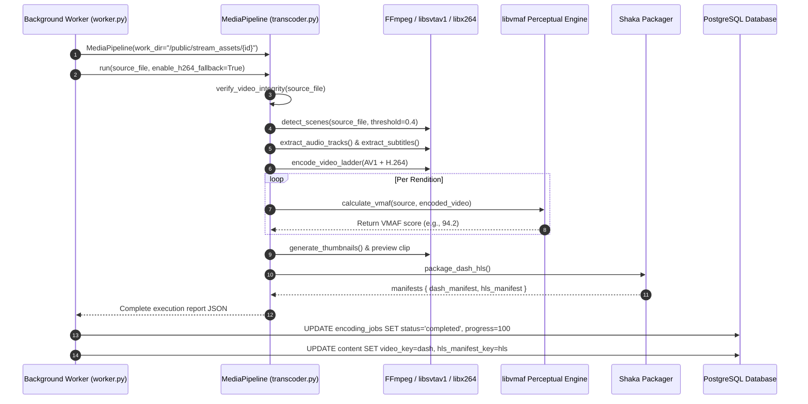

# 🎞️ StreamVault Video Ingestion & Transcoding Pipeline

| Metadata | Details |
| :--- | :--- |
| **Title** | Video Ingestion, Dual-Codec Transcoding & Packaging Specification |
| **Document ID** | STRM-001 |
| **Version** | 2.0.0 (Production Multi-Codec Enterprise Edition) |
| **Author** | Senior Streaming Systems Engineer & Video Architect |
| **Date** | 2026-09-29 |
| **Purpose** | Technical documentation of the complete video processing lifecycle, including multi-container ingestion, SHA-256 verification, SVT-AV1 and H.264 ladders, scene detection, VMAF 93+ scoring, and Google Shaka Packager packaging. |
| **Scope** | `media_server/pipeline/transcoder.py`, `media_server/pipeline/config.py`, `media_server/app/main.py`, and `media_server/app/worker.py`. |

---

## 📑 Table of Contents

- [1. Executive Pipeline Architecture](#1-executive-pipeline-architecture)
- [2. Pre-Transcode Ingestion & Integrity Verification](#2-pre-transcode-ingestion--integrity-verification)
- [3. Scene Detection & Keyframe Alignment](#3-scene-detection--keyframe-alignment)
- [4. Dual-Codec Video Encoding Ladder](#4-dual-codec-video-encoding-ladder)
  - [4.1 SVT-AV1 Primary High-Efficiency Ladder](#41-svt-av1-primary-high-efficiency-ladder)
  - [4.2 libx264 Universal Fallback Ladder](#42-libx264-universal-fallback-ladder)
  - [4.3 Codec Support Audit: H.265 (HEVC) & VP9](#43-codec-support-audit-h265-hevc--vp9)
- [5. Audio & Subtitle Processing Pipeline](#5-audio--subtitle-processing-pipeline)
- [6. Perceptual Quality Verification (VMAF 93+)](#6-perceptual-quality-verification-vmaf-93)
- [7. Storyboard Sprites & Preview Clip Generation](#7-storyboard-sprites--preview-clip-generation)
- [8. Dual MPEG-DASH & HLS Packaging Engine](#8-dual-mpeg-dash--hls-packaging-engine)
- [9. End-to-End Transcoding Execution Flow](#9-end-to-end-transcoding-execution-flow)
- [10. Storage Flow & Edge Delivery](#10-storage-flow--edge-delivery)
- [11. Gap Analysis & Production Recommendations](#11-gap-analysis--production-recommendations)
- [12. Cross References](#12-cross-references)

---

## 1. Executive Pipeline Architecture

StreamVault enforces a strict policy: **Original master uploads are source assets and are never streamed directly to end-user clients.** Every uploaded video is processed through a deterministic, reproducible transcoding and packaging pipeline:

```mermaid
graph TD
    Upload[Raw Video Upload] --> Verify[1. SHA-256 Hash & ffprobe Integrity Check]
    Verify --> Scene[2. FFmpeg Scene Detection gt(scene, 0.4)]
    
    Scene --> DemuxA[3a. Extract Audio Tracks to AAC]
    Scene --> DemuxS[3b. Demux Subtitles to WebVTT]
    Scene --> EncodeAV1[3c. SVT-AV1 Multi-Bitrate Ladder]
    Scene --> EncodeH264[3d. libx264 Fallback Ladder]
    
    EncodeAV1 --> VMAF[4. VMAF Perceptual Quality Check libvmaf]
    EncodeH264 --> VMAF
    
    Scene --> Assets[5. Generate Thumbnails & 6s Preview Clip]
    
    VMAF --> Packager[6. Google Shaka Packager 4s Segments]
    DemuxA --> Packager
    DemuxS --> Packager
    
    Packager --> MPD[MPEG-DASH: manifest.mpd]
    Packager --> M3U8[HLS: master.m3u8]
    
    MPD --> Storage[Public Stream Assets: /public/stream_assets/{id}/]
    M3U8 --> Storage
    Assets --> Storage
```

---

## 2. Pre-Transcode Ingestion & Integrity Verification

Implemented in `media_server/pipeline/transcoder.py`:
- **Cryptographic File Hash**: Calculates the full SHA-256 checksum across the raw file in 64KB chunks (`hashlib.sha256()`). This hash is verified to ensure byte-level integrity and prevent bit rot or truncation during network transmission.
- **Container Format Ingestion**: Accepts 10 industry standard media containers:
  `{ ".mp4", ".mkv", ".mov", ".avi", ".webm", ".m4v", ".flv", ".ts", ".mpeg", ".wmv" }`. Any other format immediately triggers `TranscodingError` with HTTP `400 Bad Request`.
- **Stream Probing**: Calls `ffprobe` in JSON format (`-show_format -show_streams`) to verify:
  1. Container duration $> 0.0$ seconds.
  2. Presence of at least one valid video stream (`codec_type == "video"`).
  3. Video resolution parameters (width, height) and codec identification.

---

## 3. Scene Detection & Keyframe Alignment

To eliminate visual artifacts, macroblocking, and dropped frames during client adaptive bitrate transitions, all encoding renditions must have strictly aligned GOP (Group of Pictures) boundaries locked to natural scene cuts:
- **Scene Filter**: Uses FFmpeg complex filter:
  ```bash
  ffmpeg -i source.mp4 -filter_complex "select='gt(scene,0.4)',metadata=print:file=-" -f null -
  ```
- **Keyframe Interval (`KEYFRAME_INTERVAL`)**: Fixed to **96 frames**. At 24 frames per second, this creates a deterministic IDR keyframe boundary every **4.0 seconds**.
- **Forced Keyframes**: In both AV1 and H.264 encoders, `-g 96 -keyint_min 96 -sc_threshold 0` ensures identical frame boundaries across all resolutions, allowing the player to swap renditions seamlessly mid-stream without rebuffering.

---

## 4. Dual-Codec Video Encoding Ladder

Defined in `media_server/pipeline/config.py`:

### 4.1 SVT-AV1 Primary High-Efficiency Ladder
Optimized for modern desktop and mobile browsers supporting the Royalty-Free AV1 codec. Provides 30–45% bitrate reduction over H.264 at equivalent visual quality:

| Rendition | Resolution | Target Bitrate | Peak Bitrate | Rate Control | SVT-AV1 Preset | Codec |
| :--- | :--- | :--- | :--- | :--- | :--- | :--- |
| **1080p** | $1920 \times 1080$ | 3,200 kbps | 4,000 kbps | CRF 28 | Preset 6 | `libsvtav1` |
| **720p** | $1280 \times 720$ | 1,800 kbps | 2,200 kbps | CRF 32 | Preset 6 | `libsvtav1` |
| **480p** | $854 \times 480$ | 850 kbps | 1,100 kbps | CRF 36 | Preset 7 | `libsvtav1` |
| **360p** | $640 \times 360$ | 450 kbps | 600 kbps | CRF 40 | Preset 8 | `libsvtav1` |

FFmpeg invocation for SVT-AV1:
```bash
ffmpeg -y -i source.mp4 \
  -vf "scale=w=1920:h=1080:force_original_aspect_ratio=decrease,pad=1920:1080:(ow-iw)/2:(oh-ih)/2" \
  -c:v libsvtav1 -preset 6 -crf 28 -b:v 3200k -maxrate 4000k -sc_threshold 0 \
  -g 96 -keyint_min 96 -an video_1080p.mp4
```

### 4.2 libx264 Universal Fallback Ladder
Guarantees 100% playback compatibility on legacy Android hardware, older Smart TVs, and Safari clients without AV1 hardware decoders:

| Rendition | Resolution | Target Bitrate | Peak Bitrate | Rate Control | x264 Preset | Profile | Codec |
| :--- | :--- | :--- | :--- | :--- | :--- | :--- | :--- |
| **1080p_h264** | $1920 \times 1080$ | 4,500 kbps | 5,500 kbps | CRF 23 | faster | High / yuv420p | `libx264` |
| **720p_h264** | $1280 \times 720$ | 2,500 kbps | 3,000 kbps | CRF 24 | faster | High / yuv420p | `libx264` |
| **480p_h264** | $854 \times 480$ | 1,200 kbps | 1,500 kbps | CRF 26 | faster | High / yuv420p | `libx264` |

FFmpeg invocation for libx264:
```bash
ffmpeg -y -i source.mp4 \
  -vf "scale=w=1920:h=1080:force_original_aspect_ratio=decrease,pad=1920:1080:(ow-iw)/2:(oh-ih)/2" \
  -c:v libx264 -preset faster -crf 23 -b:v 4500k -maxrate 5500k -bufsize 11000k \
  -pix_fmt yuv420p -profile:v high \
  -g 96 -keyint_min 96 -an video_1080p_h264.mp4
```

### 4.3 Codec Support Audit: H.265 (HEVC) & VP9
- **H.265 (HEVC)**: The codebase supports on-the-fly transcoding of HEVC source files when requested via the `/api/stream/media` or `/api/b2/` range streaming routes. HEVC is not currently included in the default packaging ladder to avoid patent licensing risks and client decode inconsistencies on desktop browsers.
- **VP9**: Not generated in the default pipeline ladder. Replaced directly by SVT-AV1, which provides superior compression efficiency at identical resolutions.

---

## 5. Audio & Subtitle Processing Pipeline

1. **Multi-Track Audio Extraction**:
   - Iterates through all detected audio streams in the source container.
   - Preserves language metadata tags (`tags.language`).
   - Normalizes and transcodes each audio track to clean stereo or 5.1 Advanced Audio Coding (AAC) in MP4 containers:
     ```bash
     ffmpeg -y -i source.mp4 -map 0:a:0 -c:a aac -b:a 192k -ac 2 audio_0_eng.mp4
     ```
2. **Subtitle Demuxing**:
   - Detects all subtitle streams (`codec_type == "subtitle"`).
   - Extracts and converts text/bitmap subtitles into standard WebVTT (`.vtt`) format:
     ```bash
     ffmpeg -y -i source.mp4 -map 0:s:0 sub_0_eng.vtt
     ```

---

## 6. Perceptual Quality Verification (VMAF 93+)

Every encoded video rendition is verified against the uncompressed source using Netflix's **Video Multi-Method Assessment Fusion (VMAF)** metric:
- **Target Threshold**: `TARGET_VMAF_SCORE = 93.0` (indicates broadcast-grade perceptual transparency).
- **Execution Filter**:
  ```bash
  ffmpeg -y -i source.mp4 -i video_1080p.mp4 \
    -filter_complex "[1:v]scale=1920:1080[dist];[0:v]scale=1920:1080[ref];[dist][ref]libvmaf=log_fmt=json:log_path=vmaf_1080p.json" \
    -f null -
  ```
- **Persisted Telemetry**: The pooled harmonic mean VMAF score for each rendition is saved directly to PostgreSQL (`encoding_jobs.vmaf_scores`) and accessible in the Admin console.

---

## 7. Storyboard Sprites & Preview Clip Generation

1. **Thumbnail Sprite Sheet**:
   - Extracts periodic JPEG frames every 5 seconds (`fps=1/5,scale=320:180`) with quality factor `q:v 3`:
     ```bash
     ffmpeg -y -i source.mp4 -vf "fps=1/5,scale=320:180" -q:v 3 thumb_%04d.jpg
     ```
   - Used by the video player scrub bar for instant timeline hover previews.
2. **Dynamic 6-Second Hover Preview**:
   - Cuts a 6-second representative highlight clip starting at second 10 (`-ss 00:00:10 -t 6`):
     ```bash
     ffmpeg -y -ss 00:00:10 -t 6 -i source.mp4 -vf "scale=640:360" -c:v libsvtav1 -crf 32 -an preview.mp4
     ```
   - Rendered when users hover over content cards in the browse billboard.

---

## 8. Dual MPEG-DASH & HLS Packaging Engine

Elementary video, audio, and subtitle streams are packaged into unified streaming manifests using **Google Shaka Packager**:

```bash
packager \
  in=video_1080p.mp4,stream=video,output=v_1080p.mp4,playlist_name=v_1080p.m3u8,iframe_playlist_name=v_1080p_iframe.m3u8 \
  in=video_720p.mp4,stream=video,output=v_720p.mp4,playlist_name=v_720p.m3u8,iframe_playlist_name=v_720p_iframe.m3u8 \
  in=video_1080p_h264.mp4,stream=video,output=v_1080p_h264.mp4,playlist_name=v_1080p_h264.m3u8,iframe_playlist_name=v_1080p_h264_iframe.m3u8 \
  in=audio_0_eng.mp4,stream=audio,output=a_0_eng.mp4,playlist_name=a_0_eng.m3u8,hls_group_id=audio,hls_name=eng \
  in=sub_0_eng.vtt,stream=text,output=s_0_eng.mp4,playlist_name=s_0_eng.m3u8,hls_group_id=text,hls_name=eng \
  --segment_duration 4 \
  --generate_static_live_mpd \
  --mpd_output manifest.mpd \
  --hls_master_playlist_output master.m3u8
```

### Packaging Outputs:
- `manifest.mpd`: Multi-codec MPEG-DASH XML manifest containing `<AdaptationSet>` tags for AV1 video, H.264 video, AAC audio, and WebVTT subtitles.
- `master.m3u8`: Apple HLS master multivariant playlist linking resolution-specific variant playlists (`v_1080p.m3u8`) and audio group references.

---

## 9. End-to-End Transcoding Execution Flow



---

## 10. Storage Flow & Edge Delivery

Output assets are structured hierarchically under `/public/stream_assets/{job_id}/`:
```
/public/stream_assets/14/
├── manifest.mpd                # Master MPEG-DASH manifest
├── master.m3u8                 # Master HLS multivariant playlist
├── preview.mp4                 # 6-second promotional preview clip
├── thumb_0001.jpg              # Storyboard thumbnail sprite sheet
├── thumb_0002.jpg
├── v_1080p.mp4                 # 1080p AV1 initialization header
├── v_1080p_0001.m4s            # 4-second fragmented media chunks
├── v_1080p_0002.m4s
├── v_1080p_h264.mp4            # 1080p H.264 fallback init
├── v_1080p_h264_0001.m4s
├── a_0_eng.mp4                 # Audio track initialization
├── a_0_eng_0001.m4s
└── s_0_eng.mp4                 # Subtitle initialization
```

NGINX serves these chunks with `Cache-Control: public, max-age=3600` and byte-range request support.

---

## 11. Gap Analysis & Production Recommendations

| Pipeline Feature | Implementation State | Production Recommendation |
| :--- | :--- | :--- |
| **Chunked Upload Protocol** | Missing (multipart standard POST used) | Implement TUS or S3 multipart chunk upload protocol for multi-gigabyte uploads |
| **Resume Upload Support** | Missing | Store chunk upload offset in Redis to allow resumes after connection dropouts |
| **Per-Title Encoding** | Incomplete (fixed ladder bitrates used) | Implement convex-hull dynamic bitrate laddering based on complexity probe |
| **Watermarking** | Missing | Add FFmpeg overlay filter (`drawtext` or PNG watermark) during encoding pass |
| **HDR10 / Dolby Vision** | Missing | Integrate 10-bit color grading, BT.2020 color space, and SMPTE ST 2084 PQ metadata |

---

## 12. Cross References

- [Master Documentation Hub](file:///d:/clg/Projects/Netflix/docs/README.md)
- [System Architecture](file:///d:/clg/Projects/Netflix/docs/system_architecture.md)
- [Playback & Player Engine](file:///d:/clg/Projects/Netflix/docs/playback_engine.md)
- [Admin Operations & Queue Monitoring](file:///d:/clg/Projects/Netflix/docs/admin_operations_guide.md)
- [DevOps & Kubernetes Operations](file:///d:/clg/Projects/Netflix/docs/devops_and_ci_cd.md)
