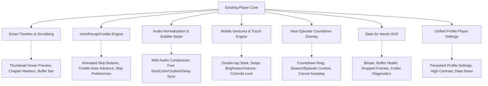

# StreamVault Video Player Architecture & Feature Gap Report (Phase 1)

## Executive Summary
This report analyzes the existing production video streaming engine within **StreamVault**, evaluating video delivery mechanisms, adaptive bitrate streaming, audio/subtitle processing, playback controls, gesture support, telemetry, and platform integrations.

---

## 1. Existing Player Architecture Overview

| Component | Current Implementation | Capabilities |
| :--- | :--- | :--- |
| **Video Engine** | Hybrid Multi-Engine | Shaka Player (DASH/HLS), Hls.js (Adaptive fallback), Native HTML5 Video (Safari/Direct MP4/WebM) |
| **Quality & ABR** | Adaptive Bitrate + Transcoding | Auto ABR with manual override (1080p, 720p, 480p, 360p), B2 CDN direct / transcode routing |
| **Audio System** | Multi-track selection | Shaka audio language selector, URL transcoding param `?audio=X` |
| **Subtitle System** | Track switching + banner | Track visibility toggling, subtitle overlay pill |
| **DRM & Security** | Anti-Piracy Forensic Watermark | Dynamic floating watermark with user ID, profile ID, session ID, anti-tamper drift |
| **Telemetry & QoE** | Telemetry Ingestion API | Beacon & fetch logging to `/api/analytics/playback` (startup latency, buffering, bitrate, dropped frames) |
| **Keyboard Navigation** | Global Keydown Handler | Space/K, F, M, Arrows, 0–9 jumps, S (Skip), P (PiP), C (Captions), ? (Help) |
| **Watch History & Sync** | Throttled Progress Ingest | Background POST to `/api/watch/progress` every 10s |

---

## 2. Feature Gap Analysis Matrix

### Detailed Gap Identification:

1. **Phase 2 — Premium Player UI**:
   - Needs auto-hiding controls with smooth cubic-bezier transitions, frosted glass blur (`backdrop-blur-2xl`), large center play/pause ripple, and mobile/TV remote responsiveness.
2. **Phase 3 — Smart Timeline**:
   - Needs chapter ticks with chapter titles on hover, dynamic hover thumbnail preview tooltip, buffered ranges visualization (`video.buffered`), and smooth seek thumb.
3. **Phase 4 — Intro / Recap / Credits**:
   - Needs animated skip buttons with glowing borders, customizable auto-skip settings, and credits detection.
4. **Phase 5 — Continue Watching**:
   - Needs an interactive "Resume from XX:XX" vs "Start from Beginning" prompt modal when starting media with previous progress > 15s.
5. **Phase 6 — Next Episode**:
   - Needs an end-credits countdown overlay (Netflix style) showing thumbnail, title, season/episode, 10s countdown timer, "Play Now", and "Cancel".
6. **Phase 7 — Audio Enhancements**:
   - Needs Web Audio API `DynamicsCompressorNode` for dialogue clarity / night mode normalization, audio track persistence in localStorage/profile, and channel format badge.
7. **Phase 8 — Subtitle Customization**:
   - Needs full subtitle appearance styling: font size (small/medium/large/extra-large), font color (white, yellow, cyan, green), background color/opacity, text shadow/outline, and subtitle delay timing (±0.5s / ±1s).
8. **Phase 9 — Advanced Playback**:
   - Needs frame stepping (forward/backward by 1 frame at 1/24 or 1/30s when paused), instant replay 10s button with badge, and quick restart.
9. **Phase 10 — Gestures & Mobile Experience**:
   - Needs double-tap left/right seek ripple animations, vertical swipe for volume (right half) and brightness (left half), touch screen lock toggle to prevent accidental touches.
10. **Phase 11 — Picture-in-Picture & Mini-Player**:
    - Needs floating draggable mini-player with restore button, volume, and play/pause controls.
11. **Phase 12 — Casting (AirPlay & Chromecast)**:
    - Needs remote playback target API integration and active casting status banner.
12. **Phase 13 & 14 — Quality & Stats for Nerds HUD**:
    - Needs real-time diagnostics HUD showing: Current Bitrate (Mbps), Resolution, Viewport Dimensions, Frame Rate, Dropped Frames, Buffer Length (seconds), Audio/Video Codecs, Player Engine.
13. **Phase 15 — Accessibility**:
    - Focus visible rings, high contrast subtitle mode, ARIA live regions for screen readers (`aria-live="polite"`).
14. **Phase 16 — Micro Animations**:
    - Ripple effects on button clicks, smooth thumbnail tooltip transitions, loading skeleton.
15. **Phase 17 — Player Settings Modal**:
    - Unified tabbed settings menu (Quality, Audio, Subtitles & Styling, Playback Speed, Preferences with Autoplay and Auto-Skip toggles).
16. **Phase 18 — Analytics & Telemetry**:
    - Track seek events, pause/resume, quality changes, audio changes, and completion rate calculations.
17. **Phase 19 & 20 — Performance & Testing**:
    - Memoized subcomponents, automated test suite covering all player modules, controls, time formatting, and subtitle calculation.

---

## 3. Implementation Plan
We will implement these upgrades cleanly, modularly, and with zero breaking changes, reusing existing types, APIs, and styles.
